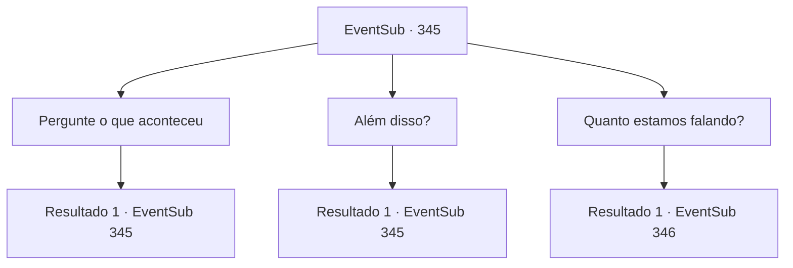

# Eventos secundários · 345

[Índice da tabela](index.md) · [Índice geral](../index.md)

ID: `pt:EventSub:345` · Fonte: `EventSub4` · Versão: 1.2.47.

Mapeamento estático dos arquivos; a disponibilidade e a execução dependem do estado da run.

## Texto do evento

*Sem texto no arquivo.*

## Dados de entrada

```json
{
  "id": 345,
  "grade": 1,
  "subEvent": "",
  "required": ""
}
```

## Mapa das escolhas



## Escolhas e resultados

### Escolha 1

Pergunte o que aconteceu

Requisitos e outros campos da escolha:

```json
{
  "required": "5_324_0"
}
```

#### Resultado 1.1

Você pergunta a Amakar por que ele roubou a jóia. Ele se senta em uma cadeira na sala e respostas. 

 "Eu vivi para servir a natureza e cuidar da floresta. Como os outros druidas, obedecendo à disciplina estrita. Mas um dia, um dos anciãos me acusou como o 'futuro destruidor da floresta', depois de ter um sonho."

 Amakar suspira e continua. 

 "O que é ainda mais absurdo? Os outros acreditavam nas palavras do ancião. Eles me deixaram de fora gradualmente ... e acabei ficando sozinho. Foi quando conheci Selis."

 Segundo ele, Selis, filha de Lord Tomant, veio à Floresta Silociente para encontrar uma maneira de salvar o árido Tomant. 

 "Ela era completamente diferente dos selvagens da floresta. Eu me apaixonei à primeira vista e pensei que poderia fazer qualquer coisa por ela. Então a jóia da vida veio à mente. A jóia era poderosa o suficiente para tornar suas esperanças realidade. Além do mais..."


Continuação registrada: [Evento 345](0345.md) na mesma tabela.

```json
{
  "required": "",
  "chance": "1",
  "nextEvent": 345,
  "type": 2,
  "reward": "5_324_1"
}
```

### Escolha 2

Além disso?

Requisitos e outros campos da escolha:

```json
{
  "required": "5_324_1"
}
```

#### Resultado 2.1

Após beber seu chá, Amakar retoma seu discurso. 

 "Não havia lugar para mim na Floresta de Silocient, de qualquer forma. Peguei a joia sem hesitação e escapei da floresta com Selis."

 Após chegar em Tomant com Selis, ele usou o poder da joia. A terra árida se transformou em solo fértil e um rio seco voltou a fluir. Graças à joia, uma pequena cidade, que era visitada apenas ocasionalmente por aventureiros, se transformou em uma cidade enorme, e os moradores ganharam uma vida feliz. 

 "Se você pegar a Joia da Vida, toda a cidade será arruinada, sem mencionar as pessoas."

 Amakar abaixa a cabeça, implorando para que você desista da Joia da Vida.

Continuação registrada: [Evento 345](0345.md) na mesma tabela.

```json
{
  "required": "",
  "chance": "1",
  "nextEvent": 345,
  "type": 2,
  "reward": "5_324_2"
}
```

### Escolha 3

Quanto estamos falando?

Requisitos e outros campos da escolha:

```json
{
  "required": "5_324_2"
}
```

#### Resultado 3.1

Você pergunta a ele quanto ele pode te dar. Ele responde, 100 ouro. Ele também mostra a você uma bolsa cheia de 100 ouro, para que você possa ver.

Continuação registrada: [Evento 346](0346.md) na mesma tabela.

```json
{
  "required": "",
  "chance": "1",
  "nextEvent": 346,
  "type": 2,
  "reward": ""
}
```

## Referências que chegam a este evento

- [Evento 344 · escolha 1 · resultado 1](0344.md#escolha-1)
- [Evento 344 · escolha 1 · resultado 3](0344.md#escolha-1)
- [Evento 344 · escolha 2 · resultado 1](0344.md#escolha-2)
- [Evento 345 · escolha 1 · resultado 1](0345.md#escolha-1)
- [Evento 345 · escolha 2 · resultado 1](0345.md#escolha-2)
- [Evento 347 · escolha 1 · resultado 1](0347.md#escolha-1)
