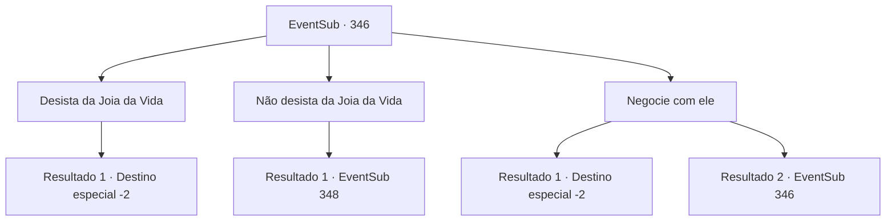

# Eventos secundários · 346

[Índice da tabela](index.md) · [Índice geral](../index.md)

ID: `pt:EventSub:346` · Fonte: `EventSub4` · Versão: 1.2.47.

Mapeamento estático dos arquivos; a disponibilidade e a execução dependem do estado da run.

## Texto do evento

*Sem texto no arquivo.*

## Dados de entrada

```json
{
  "id": 346,
  "grade": 1,
  "subEvent": "",
  "required": ""
}
```

## Mapa das escolhas



## Escolhas e resultados

### Escolha 1

Desista da Joia da Vida

Requisitos e outros campos da escolha:

```json
{
  "required": ""
}
```

#### Resultado 1.1

Finalmente, você cede ao seu pedido. Enquanto sai da mansão silenciosamente, Amakar agradece várias vezes, inclinando a cabeça novamente.

Continuação registrada: [Destino especial `-2`](../destinos-especiais.md).

```json
{
  "required": "",
  "chance": "1",
  "nextEvent": -2,
  "type": 2,
  "reward": "12_8_4|0_4_100"
}
```

### Escolha 2

Não desista da Joia da Vida

Requisitos e outros campos da escolha:

```json
{
  "required": ""
}
```

#### Resultado 2.1

Você balança a cabeça, dizendo a ele que não pode simplesmente desistir da Joia da Vida. Amakar suspira. 

 "Tudo bem, então. Vou fazer você desistir."

 Num piscar de olhos, o corpo de Amakar começa a crescer, com uma camada de pelos cobrindo sua pele. Sua boca logo se transforma em um focinho, e suas unhas se tornam afiadas, como pares de garras bestiais. Agora ele se parece mais com um urso negro do que com um humano. Ele ruge de raiva, e você também se prepara com sua arma.

Continuação registrada: [Evento 348](0348.md) na mesma tabela.

```json
{
  "required": "",
  "chance": "1",
  "nextEvent": 348,
  "type": 2,
  "reward": "6_0_133",
  "place": 10
}
```

### Escolha 3

Negocie com ele

Requisitos e outros campos da escolha:

```json
{
  "required": "5_325_0"
}
```

#### Resultado 3.1

Você negocia com ele, pedindo mais ouro. Depois de refletir um pouco, Amakar adiciona mais 50 ouro. Você pega o ouro dele e sai da mansão silenciosamente.

Continuação registrada: [Destino especial `-2`](../destinos-especiais.md).

```json
{
  "required": "",
  "chance": "1|0_12_1",
  "nextEvent": -2,
  "type": 0,
  "reward": "0_4_150|12_8_4"
}
```

#### Resultado 3.2

Você negocia por mais e Amakar parece preocupado. 

 "Desculpe... Mas acho que isso é o bastante."

 Ele diz que se você não sair da cidade silenciosamente como ele sugeriu, ele não terá escolha a não ser tomar a 'opção um pouco radical'.

Continuação registrada: [Evento 346](0346.md) na mesma tabela.

```json
{
  "required": "",
  "chance": "11",
  "nextEvent": 346,
  "type": 1,
  "reward": "5_325_1"
}
```

## Referências que chegam a este evento

- [Evento 345 · escolha 3 · resultado 1](0345.md#escolha-3)
- [Evento 346 · escolha 3 · resultado 2](0346.md#escolha-3)
