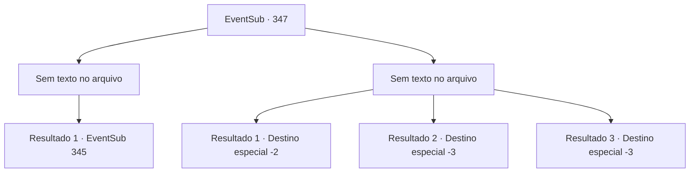

# Eventos secundários · 347

[Índice da tabela](index.md) · [Índice geral](../index.md)

ID: `pt:EventSub:347` · Fonte: `EventSub4` · Versão: 1.2.47.

Mapeamento estático dos arquivos; a disponibilidade e a execução dependem do estado da run.

## Texto do evento

*Sem texto no arquivo.*

## Dados de entrada

```json
{
  "id": 347,
  "grade": 1,
  "subEvent": "",
  "required": ""
}
```

## Mapa das escolhas



## Escolhas e resultados

### Escolha 1

*Sem texto no arquivo; o papel dessa opção depende da interface do jogo.*

Requisitos e outros campos da escolha:

```json
{
  "required": ""
}
```

#### Resultado 1.1

Você derruba os guardas e recupera o fôlego. Então, uma voz pode ser ouvida vindo de suas costas. 

 "Pare com isso imediatamente! Do que se trata tudo isso?!"

 Julgando pela cicatriz em sua bochecha, você percebe que este é o homem que está procurando. Quando você diz a ele que está aqui pelos druidas da Floresta de Silocient, ele o leva para o quarto de hóspedes dentro da mansão. Ele retorna com uma xícara de chá. Após uma breve hesitação, ele reúne coragem para falar. 

 "Por favor, você poderia... sair silenciosamente? Posso lhe dar algo valioso, se desejar."


Continuação registrada: [Evento 345](0345.md) na mesma tabela.

```json
{
  "required": "",
  "chance": "1",
  "nextEvent": 345,
  "type": 2,
  "reward": ""
}
```

### Escolha 2

*Sem texto no arquivo; o papel dessa opção depende da interface do jogo.*

Requisitos e outros campos da escolha:

```json
{
  "required": ""
}
```

#### Resultado 2.1

Os guardas não mostram piedade para o aventureiro sinistro. Depois de escapar por pouco da lança, você percebe que não tem chance e foge.

Continuação registrada: [Destino especial `-2`](../destinos-especiais.md).

```json
{
  "required": "1_0_2|1_1_2",
  "chance": "1",
  "nextEvent": -2,
  "type": 2,
  "reward": "0_0_-1|0_1_-1|12_8_2"
}
```

#### Resultado 2.2

Os guardas não mostram piedade para o aventureiro sinistro. As lâminas afiadas afundam em seu peito.

Continuação registrada: [Destino especial `-3`](../destinos-especiais.md).

```json
{
  "required": "2_0_2",
  "chance": "1",
  "nextEvent": -3,
  "type": 2,
  "reward": "0_0_-1|0_1_-1"
}
```

#### Resultado 2.3

Os guardas não mostram piedade para o aventureiro sinistro. As lâminas afiadas afundam em seu peito.

Continuação registrada: [Destino especial `-3`](../destinos-especiais.md).

```json
{
  "required": "2_1_2",
  "chance": "1",
  "nextEvent": -3,
  "type": 2,
  "reward": "0_0_-1|0_1_-1"
}
```

## Referências que chegam a este evento

- [Evento 344 · escolha 1 · resultado 2](0344.md#escolha-1)
