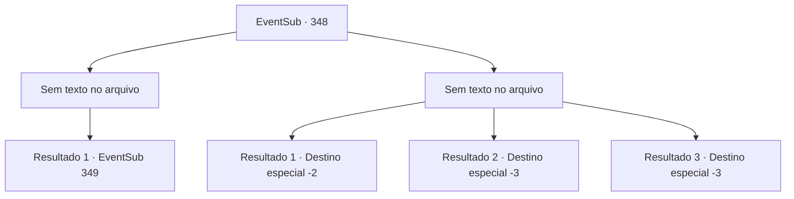

# Eventos secundários · 348

[Índice da tabela](index.md) · [Índice geral](../index.md)

ID: `pt:EventSub:348` · Fonte: `EventSub4` · Versão: 1.2.47.

Mapeamento estático dos arquivos; a disponibilidade e a execução dependem do estado da run.

## Texto do evento

*Sem texto no arquivo.*

## Dados de entrada

```json
{
  "id": 348,
  "grade": 1,
  "subEvent": "",
  "required": ""
}
```

## Mapa das escolhas



## Escolhas e resultados

### Escolha 1

*Sem texto no arquivo; o papel dessa opção depende da interface do jogo.*

Requisitos e outros campos da escolha:

```json
{
  "required": ""
}
```

#### Resultado 1.1

Amakar se transforma em um urso para lutar contra você, mas ainda não é páreo para você. Você pede pelo Joia da Vida, com sua arma encostada em seu pescoço. 

 "Me mate. Eu prefiro morrer do que ser roubado dela."

 Ele não parece dizer onde escondeu a joia.

Continuação registrada: [Evento 349](0349.md) na mesma tabela.

```json
{
  "required": "",
  "chance": "1",
  "nextEvent": 349,
  "type": 2,
  "reward": ""
}
```

### Escolha 2

*Sem texto no arquivo; o papel dessa opção depende da interface do jogo.*

Requisitos e outros campos da escolha:

```json
{
  "required": ""
}
```

#### Resultado 2.1

O urso que é Amakar te atinge com sua pata. Após receber o golpe, você cambaleia antes de fugir. Felizmente, Amakar não te persegue.

Continuação registrada: [Destino especial `-2`](../destinos-especiais.md).

```json
{
  "required": "1_0_2|1_1_2",
  "chance": "1",
  "nextEvent": -2,
  "type": 2,
  "reward": "0_0_-1|0_1_-1|12_8_2"
}
```

#### Resultado 2.2

A última coisa que você se lembra é a forma de urso de Amakar. Suas garras afiadas te despedaçam em pedaços.

Continuação registrada: [Destino especial `-3`](../destinos-especiais.md).

```json
{
  "required": "2_0_2",
  "chance": "1",
  "nextEvent": -3,
  "type": 2,
  "reward": "0_0_-1|0_1_-1"
}
```

#### Resultado 2.3

A última coisa que você se lembra é a forma de urso de Amakar. Suas garras afiadas te despedaçam em pedaços.

Continuação registrada: [Destino especial `-3`](../destinos-especiais.md).

```json
{
  "required": "2_1_2",
  "chance": "1",
  "nextEvent": -3,
  "type": 2,
  "reward": "0_0_-1|0_1_-1"
}
```

## Referências que chegam a este evento

- [Evento 346 · escolha 2 · resultado 1](0346.md#escolha-2)
