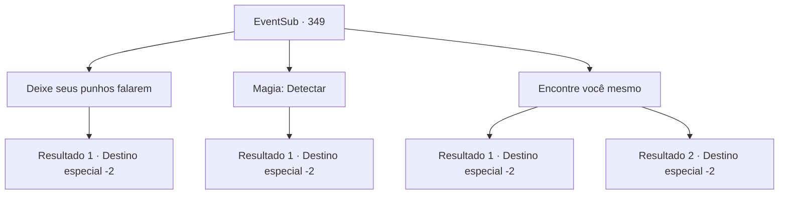

# Eventos secundários · 349

[Índice da tabela](index.md) · [Índice geral](../index.md)

ID: `pt:EventSub:349` · Fonte: `EventSub4` · Versão: 1.2.47.

Mapeamento estático dos arquivos; a disponibilidade e a execução dependem do estado da run.

## Texto do evento

*Sem texto no arquivo.*

## Dados de entrada

```json
{
  "id": 349,
  "grade": 1,
  "subEvent": "",
  "required": ""
}
```

## Mapa das escolhas



## Escolhas e resultados

### Escolha 1

Deixe seus punhos falarem

Requisitos e outros campos da escolha:

```json
{
  "required": "2_3_0"
}
```

#### Resultado 1.1

Você começa a bater em Amakar. Enquanto o questiona com seu punho, a porta se abre e uma mulher entra. Amakar grita urgentemente. 

 "E...Espere!! Selis! Fuja, agora!!"

 A mulher é a esposa de Amakar e filha do Senhor Tomant, Selis. Ao ver a condição de Amakar, seu rosto fica branco. No entanto, ela fala calmamente. 

 "E...espere. Me diga o que você quer, e eu te darei. Em troca, por favor, deixe meu marido em paz a partir de agora."

 Você faz com que ela te traga a Joia da Vida. Enquanto Selis retira um livro da estante, a estante se move e revela um espaço oculto. Ela entra e traz um gem amarela. Você pode sentir ela pulsando por conta própria, emitindo um calor misterioso. Você pega a joia e sai da mansão de Amakar.

Continuação registrada: [Destino especial `-2`](../destinos-especiais.md).

```json
{
  "required": "",
  "chance": "1",
  "nextEvent": -2,
  "type": 2,
  "reward": "3_239_1|12_8_3|0_2_1|0_3_-1"
}
```

### Escolha 2

Magia: Detectar

Requisitos e outros campos da escolha:

```json
{
  "required": "20_0_1"
}
```

#### Resultado 2.1

Você lança um feitiço para detectar o fluxo mágico que a Joia da Vida emana. Então você percebe uma energia vigorosa transbordando atrás da estante de livros. Você quebra a estante de livros e segue para o espaço escondido atrás dela. O pequeno quarto está quase vazio, exceto por uma prateleira de madeira e uma gema amarela colocada sobre ela. A joia está pulsando por si só, emitindo um calor misterioso. 

 "Ah, não..."

 Ignorando o gemido de Amakar, você pega a joia e sai da mansão.

Continuação registrada: [Destino especial `-2`](../destinos-especiais.md).

```json
{
  "required": "",
  "chance": "1",
  "nextEvent": -2,
  "type": 2,
  "reward": "3_239_1|12_8_3|0_2_1"
}
```

### Escolha 3

Encontre você mesmo

Requisitos e outros campos da escolha:

```json
{
  "required": ""
}
```

#### Resultado 3.1

Você olha ao redor do quarto e sente um calor sutil emanando da estante de livros. Investigando a estante de livros, você nota um livro com uma capa especialmente desgastada. Você retira o livro e a estante de livros se move revelando um espaço escondido. O pequeno quarto está quase vazio, exceto por uma prateleira de madeira e uma gema amarela colocada sobre ela. A joia está pulsando por si só, emitindo um calor misterioso. 

 "Ah, não..."

 Ignorando o gemido de Amakar, você pega a joia e sai da mansão.

Continuação registrada: [Destino especial `-2`](../destinos-especiais.md).

```json
{
  "required": "",
  "chance": "1|0_14_1",
  "nextEvent": -2,
  "type": 0,
  "reward": "3_239_1|12_8_3|0_2_1"
}
```

#### Resultado 3.2

Você olha ao redor do quarto. No entanto, não importa o quanto você procure, você não consegue encontrar a joia escondida. Você olha de volta para questionar Amakar novamente, mas ele já fugiu. Você não tem escolha a não ser sair da mansão de mãos vazias.

Continuação registrada: [Destino especial `-2`](../destinos-especiais.md).

```json
{
  "required": "",
  "chance": "22",
  "nextEvent": -2,
  "type": 1,
  "reward": "12_8_2"
}
```

## Referências que chegam a este evento

- [Evento 348 · escolha 1 · resultado 1](0348.md#escolha-1)
