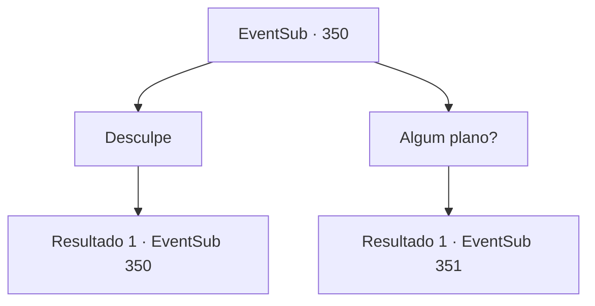

# Eventos secundários · 350

[Índice da tabela](index.md) · [Índice geral](../index.md)

ID: `pt:EventSub:350` · Fonte: `EventSub4` · Versão: 1.2.47.

Mapeamento estático dos arquivos; a disponibilidade e a execução dependem do estado da run.

## Texto do evento

Você chega na Floresta Silociente e percebe uma atmosfera agitada. Os druidas, reunidos em um só lugar, estão falando alto. Conforme você se aproxima, Syannathel olha para trás e pergunta. 

 "Como foi? Onde está a Jóia da Vida?"

 Enquanto você balança a cabeça, ela lhe dá um olhar desapontado.

## Dados de entrada

```json
{
  "id": 350,
  "grade": 1,
  "subEvent": "",
  "required": "12_8_2"
}
```

## Mapa das escolhas



## Escolhas e resultados

### Escolha 1

Desculpe

Requisitos e outros campos da escolha:

```json
{
  "required": "5_320_0"
}
```

#### Resultado 1.1

Você se desculpa por sua falha. Syannathel balança a cabeça, e os outros druidas fazem o mesmo. Depois de um tempo, Syannathel quebra o silêncio. 

 "Agora... Não temos escolha a não ser nos tornarmos radicais."


Continuação registrada: [Evento 350](0350.md) na mesma tabela.

```json
{
  "required": "",
  "chance": "1",
  "nextEvent": 350,
  "type": 2,
  "reward": "5_320_1"
}
```

### Escolha 2

Algum plano?

Requisitos e outros campos da escolha:

```json
{
  "required": "5_320_1"
}
```

#### Resultado 2.1

Na sua pergunta, ela pega um pergaminho e a coloca na mesa. É um mapa de Tomant na visão panorâmica de um pássaro. 

 "Se marcharmos de frente, o dano será imenso. Em vez disso, seremos divididos em duas unidades. A primeira unidade atrai atenção, E os outros se infiltram na mansão de Amakar. Enquanto a 'unidade de isca' cria perturbações, a 'unidade de infiltração' recuperará a jóia e enviará um sinal. Se a 'unidade de isca' foge com segurança, chamamos a operação de sucesso."


Continuação registrada: [Evento 351](0351.md) na mesma tabela.

```json
{
  "required": "",
  "chance": "1",
  "nextEvent": 351,
  "type": 2,
  "reward": "5_320_2"
}
```

## Referências que chegam a este evento

- [Evento 350 · escolha 1 · resultado 1](0350.md#escolha-1)
