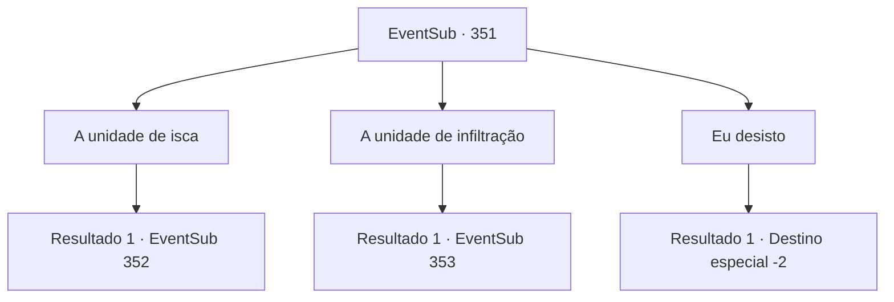

# Eventos secundários · 351

[Índice da tabela](index.md) · [Índice geral](../index.md)

ID: `pt:EventSub:351` · Fonte: `EventSub4` · Versão: 1.2.47.

Mapeamento estático dos arquivos; a disponibilidade e a execução dependem do estado da run.

## Texto do evento

*Sem texto no arquivo.*

## Dados de entrada

```json
{
  "id": 351,
  "grade": 1,
  "subEvent": "",
  "required": ""
}
```

## Mapa das escolhas



## Escolhas e resultados

### Escolha 1

A unidade de isca

Requisitos e outros campos da escolha:

```json
{
  "required": ""
}
```

#### Resultado 1.1

Você decide criar caos na cidade e atrair atenção. Você e alguns druidas se inscrevem na 'Unidade de isca'. Você vai para Tomant com eles. 

 Alguns dias depois, você e os druidas chegam a Tomant. Antes de entrar na cidade, os druidas ensaiam os planos. 

 "Tenho certeza que você se lembra. Nós fofamos quando o sinal surge, ou depois de passarmos 30 minutos por aí."

 Ao entrar na cidade, os druidas começam a chamar a atenção apenas com suas roupas. 

 "Chame o deputado do proprietário imediatamente!"

 "Amakar !! Saia de uma vez e enfrente os irmãos que você abandonou !!"

 Os druidas rugem como Thunder e, em vez de Amakar, os guardas da cidade são provocados. 

 "Aqueles animais não civilizados ...!"

 Enquanto os guardas tiram suas armas, os druidas ficam loucos e jogam fora de suas capas. Em um instante, os druidas se transformam em um tigre, uma árvore, um urso e assim por diante. A luta começa.

Continuação registrada: [Evento 352](0352.md) na mesma tabela.

```json
{
  "required": "",
  "chance": "1",
  "nextEvent": 352,
  "type": 2,
  "reward": "6_0_135",
  "place": 4
}
```

### Escolha 2

A unidade de infiltração

Requisitos e outros campos da escolha:

```json
{
  "required": ""
}
```

#### Resultado 2.1

Você decide entrar na mansão de Amakar. Você e Syannathel formam 'a unidade de infiltração'. Você vai para Tomant com ela. 

 Alguns dias depois, você e Syannathel chegam a Tomant. Depois de um tempo, os guardas da cidade correm para uma esquina. 

 "Parece que a unidade de isca iniciou a operação. Deveríamos ir também."

 Ela se transforma em uma águia gigante, agarra você com suas garras e sobe no céu. Em um instante, você chega ao teto da mansão de Amakar. Syannathel coloca você no chão e fala. 

 "Vou investigar do lado direito da mansão. Você poderia começar do lado esquerdo? Ah, e pegue este rolagem de sinal. Basta destruí -lo quando encontrar a jóia. Se não houver sinal em 30 minutos, fuja imediatamente."

 Logo depois, ela voa para o outro lado da mansão. Agora você precisa descobrir como se esgueirar em silêncio.

Continuação registrada: [Evento 353](0353.md) na mesma tabela.

```json
{
  "required": "",
  "chance": "1",
  "nextEvent": 353,
  "type": 2,
  "reward": "3_54_1"
}
```

### Escolha 3

Eu desisto

Requisitos e outros campos da escolha:

```json
{
  "required": "18_326_1"
}
```

#### Resultado 3.1

Você decide não correr mais riscos. Os druidas, incluindo Syannathel, parecem arrependidos. 

 "Certo... É uma pena, mas entendemos. Obrigado por nos ajudar até agora."

 Você se despede deles e deixa a Floresta de Silocient.

Continuação registrada: [Destino especial `-2`](../destinos-especiais.md).

```json
{
  "required": "",
  "chance": "1",
  "nextEvent": -2,
  "type": 2,
  "reward": "12_8_-1"
}
```

## Referências que chegam a este evento

- [Evento 350 · escolha 2 · resultado 1](0350.md#escolha-2)
- [Evento 366 · escolha 1 · resultado 1](0366.md#escolha-1)
