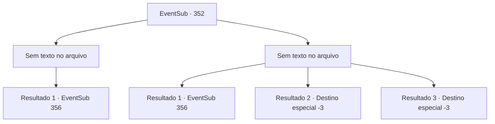

# Eventos secundários · 352

[Índice da tabela](index.md) · [Índice geral](../index.md)

ID: `pt:EventSub:352` · Fonte: `EventSub4` · Versão: 1.2.47.

Mapeamento estático dos arquivos; a disponibilidade e a execução dependem do estado da run.

## Texto do evento

*Sem texto no arquivo.*

## Dados de entrada

```json
{
  "id": 352,
  "grade": 1,
  "subEvent": "",
  "required": ""
}
```

## Mapa das escolhas



## Escolhas e resultados

### Escolha 1

*Sem texto no arquivo; o papel dessa opção depende da interface do jogo.*

Requisitos e outros campos da escolha:

```json
{
  "required": ""
}
```

#### Resultado 1.1

À medida que você derruba alguns guardas, a comoção fica mais alta. Então Amakar aparece entre os guardas. 

 "Amakar!! Você traidor!"

 Amakar vê os druidas bufando de raiva e esfrega a testa. 

 "Você me traiu primeiro. Você não se lembra de me deixar de fora, apenas por causa de um único sonho? Saia da cidade imediatamente. Caso contrário, seus corpos serão pendurados nas paredes."

 Apesar do aviso de Amakar, os druidas não têm intenção de sair. O sinal ainda não veio da mansão. 

 "Melhor segurar sua língua suja, traidor."

 A luta, que havia parado por um tempo, recomeça e os homens de Amakar avançam em direção aos druidas.

Continuação registrada: [Evento 356](0356.md) na mesma tabela.

```json
{
  "required": "",
  "chance": "1",
  "nextEvent": 356,
  "type": 2,
  "reward": "6_0_136",
  "place": 4
}
```

### Escolha 2

*Sem texto no arquivo; o papel dessa opção depende da interface do jogo.*

Requisitos e outros campos da escolha:

```json
{
  "required": ""
}
```

#### Resultado 2.1

Acertado por um guarda, você rola no chão. Logo antes de sua lança te perfurar, um galho de treant bloqueia o caminho. 

 "Você está bem? Recupere-se."

 Você deve sua vida ao druida. Enquanto isso, Amakar aparece entre os guardas. 

 "Amakar!! Traidor!"

 Amakar vê os druidas bufando de raiva e esfrega a testa. 

 "Você me traiu primeiro. Você não se lembra de me deixar de fora, apenas por causa de um único sonho? Saia da cidade imediatamente. Caso contrário, seus corpos serão pendurados nos muros."

 Apesar do aviso de Amakar, os druidas não têm intenção de sair. O sinal ainda não veio da mansão. 

 "Melhor segurar sua língua suja, traidor."

 A luta, que havia parado por um tempo, recomeça e os homens de Amakar avançam em direção aos druidas.

Continuação registrada: [Evento 356](0356.md) na mesma tabela.

```json
{
  "required": "1_0_2|1_1_2",
  "chance": "1",
  "nextEvent": 356,
  "type": 2,
  "reward": "6_0_136|0_0_-1|0_1_-1",
  "place": 4
}
```

#### Resultado 2.2

Acertado por um guarda, você rola no chão. Logo em seguida, uma lança salta e perfura seu estômago.

Continuação registrada: [Destino especial `-3`](../destinos-especiais.md).

```json
{
  "required": "2_0_2",
  "chance": "1",
  "nextEvent": -3,
  "type": 2,
  "reward": "0_0_-1|0_1_-1"
}
```

#### Resultado 2.3

Acertado por um guarda, você rola no chão. Logo em seguida, uma lança salta e perfura seu estômago.

Continuação registrada: [Destino especial `-3`](../destinos-especiais.md).

```json
{
  "required": "2_1_2",
  "chance": "1",
  "nextEvent": -3,
  "type": 2,
  "reward": "0_0_-1|0_1_-1"
}
```

## Referências que chegam a este evento

- [Evento 351 · escolha 1 · resultado 1](0351.md#escolha-1)
