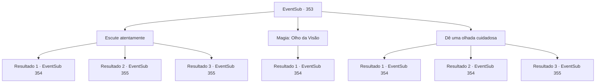

# Eventos secundários · 353

[Índice da tabela](index.md) · [Índice geral](../index.md)

ID: `pt:EventSub:353` · Fonte: `EventSub4` · Versão: 1.2.47.

Mapeamento estático dos arquivos; a disponibilidade e a execução dependem do estado da run.

## Texto do evento

*Sem texto no arquivo.*

## Dados de entrada

```json
{
  "id": 353,
  "grade": 1,
  "subEvent": "",
  "required": ""
}
```

## Mapa das escolhas



## Escolhas e resultados

### Escolha 1

Escute atentamente

Requisitos e outros campos da escolha:

```json
{
  "required": ""
}
```

#### Resultado 1.1

Você fecha os olhos e escuta atentamente. Em seguida, dirige-se à varanda onde nenhum passo é ouvido. Você abre a janela e entra no quarto. Está vazio, como você pressentiu. No quarto, há todo tipo de estantes ao longo da parede e peles de veado no chão. Você nota um retrato de Amakar e uma mulher, pendurados na parede. Você conseguiu se infiltrar com sucesso na mansão de Amakar e agora precisa descobrir onde o Jewel of Life está escondido.

Continuação registrada: [Evento 354](0354.md) na mesma tabela.

```json
{
  "required": "",
  "chance": "1|0_14_1",
  "nextEvent": 354,
  "type": 0,
  "reward": ""
}
```

#### Resultado 1.2

Você fecha os olhos e escuta atentamente. No entanto, o barulho ao seu redor perturba sua concentração. Você abre uma janela aleatória e entra no quarto. O quarto tem uma cama com um dossel branco e uma pequena mesa de café. Você se depara com uma empregada que está limpando o quarto. Ela te encara surpresa.

Continuação registrada: [Evento 355](0355.md) na mesma tabela.

```json
{
  "required": "",
  "chance": "15",
  "nextEvent": 355,
  "type": 1,
  "reward": ""
}
```

#### Resultado 1.3

Você fecha os olhos e escuta atentamente. No entanto, há uma perturbação constante em sua mente. A ansiedade de que você possa falhar impede que você se concentre. Você balança a cabeça para se livrar das distrações, abre uma janela aleatória e entra no quarto. O quarto tem uma cama com um dossel branco e uma pequena mesa de café. Você encontra uma empregada que está limpando o quarto. Ela te encara surpresa.

Continuação registrada: [Evento 355](0355.md) na mesma tabela.

```json
{
  "required": "21_2_0",
  "chance": "25",
  "nextEvent": 355,
  "type": 1,
  "reward": ""
}
```

### Escolha 2

Magia: Olho da Visão

Requisitos e outros campos da escolha:

```json
{
  "required": "20_0_2"
}
```

#### Resultado 2.1

Você conjura um olho transparente e o envia pela janela. Você olha ao redor da mansão através do olho e avista uma sala mobiliada com todo tipo de estantes ao longo da parede e peles de veado no chão. Há um retrato de Amakar e uma mulher pendurado na parede. Parece ser o escritório de Amakar. Você entra na sala pelo balcão. Você conseguiu se infiltrar com sucesso na mansão de Amakar e agora precisa descobrir onde o Jewel of Life está escondido.

Continuação registrada: [Evento 354](0354.md) na mesma tabela.

```json
{
  "required": "",
  "chance": "1",
  "nextEvent": 354,
  "type": 2,
  "reward": ""
}
```

### Escolha 3

Dê uma olhada cuidadosa

Requisitos e outros campos da escolha:

```json
{
  "required": ""
}
```

#### Resultado 3.1

Você olha para dentro da mansão através da varanda, tão quieto como um rato. O quarto tem uma cama com um dossel branco e uma pequena mesa de café. Uma empregada está limpando o quarto, mas ela não percebe sua presença. Você segue para outra varanda em silêncio e observa mais adiante. Desta vez você avista um quarto mobiliado com todos os tipos de estantes ao longo da parede e peles de veado no chão. Há um retrato de Amakar e uma mulher pendurado na parede. Parece ser o escritório de Amakar. Você entra no quarto através da varanda. Você conseguiu se infiltrar com sucesso na mansão de Amakar e agora precisa descobrir onde está escondida a Joia da Vida.

Continuação registrada: [Evento 354](0354.md) na mesma tabela.

```json
{
  "required": "",
  "chance": "1|0_6_1",
  "nextEvent": 354,
  "type": 0,
  "reward": ""
}
```

#### Resultado 3.2

Você olha para dentro da mansão através da varanda, tão quieto como um rato. O quarto tem uma cama com um dossel branco e uma pequena mesa de café. Uma empregada está limpando o quarto, mas ela não percebe sua presença. Você segue para outra varanda em silêncio e observa mais adiante. Desta vez você avista um quarto mobiliado com todos os tipos de estantes ao longo da parede e peles de veado no chão. Há um retrato de Amakar e uma mulher pendurado na parede. Parece ser o escritório de Amakar. Você entra no quarto através da varanda. Você conseguiu se infiltrar com sucesso na mansão de Amakar e agora precisa descobrir onde está escondida a Joia da Vida.

Continuação registrada: [Evento 354](0354.md) na mesma tabela.

```json
{
  "required": "20_5_2",
  "chance": "1|0_6_1",
  "nextEvent": 354,
  "type": 0,
  "reward": ""
}
```

#### Resultado 3.3

Você olha para dentro da mansão através da varanda, tão quieto quanto um rato. O quarto tem uma cama com um dossel branco e uma pequena mesa de café. Você se depara com uma empregada que está limpando o quarto. Ela te encara surpresa.

Continuação registrada: [Evento 355](0355.md) na mesma tabela.

```json
{
  "required": "",
  "chance": "22",
  "nextEvent": 355,
  "type": 1,
  "reward": ""
}
```

## Referências que chegam a este evento

- [Evento 351 · escolha 2 · resultado 1](0351.md#escolha-2)
