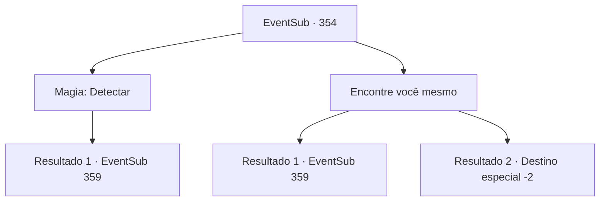

# Eventos secundários · 354

[Índice da tabela](index.md) · [Índice geral](../index.md)

ID: `pt:EventSub:354` · Fonte: `EventSub4` · Versão: 1.2.47.

Mapeamento estático dos arquivos; a disponibilidade e a execução dependem do estado da run.

## Texto do evento

*Sem texto no arquivo.*

## Dados de entrada

```json
{
  "id": 354,
  "grade": 1,
  "subEvent": "",
  "required": ""
}
```

## Mapa das escolhas



## Escolhas e resultados

### Escolha 1

Magia: Detectar

Requisitos e outros campos da escolha:

```json
{
  "required": "20_0_1"
}
```

#### Resultado 1.1

Você lança um feitiço para detectar o fluxo mágico que a Joia da Vida emana. Então você percebe uma energia vigorosa transbordando atrás da estante de livros. Você quebra a estante de livros e segue para o espaço escondido atrás dela. A pequena sala está quase vazia, exceto por uma prateleira de madeira e uma gema amarela colocada sobre ela. A joia está pulsando por si só, emitindo um calor misterioso. Você pega a Joia da Vida. Pouco depois, Syannathel desliza para a varanda.

Continuação registrada: [Evento 359](0359.md) na mesma tabela.

```json
{
  "required": "",
  "chance": "1",
  "nextEvent": 359,
  "type": 2,
  "reward": "3_239_1|12_8_5|5_327_1"
}
```

### Escolha 2

Encontre você mesmo

Requisitos e outros campos da escolha:

```json
{
  "required": ""
}
```

#### Resultado 2.1

Você olha ao redor do quarto e sente um calor sutil emanando da estante de livros. Investigando a estante de livros, você nota um livro com uma capa especialmente desgastada. Você retira o livro e a estante de livros se move revelando um espaço escondido. O pequeno quarto está quase vazio, exceto por uma prateleira de madeira e uma joia amarela colocada sobre ela. A joia está pulsando por si só, emitindo um calor misterioso. Você pega a Joia da Vida. Logo em seguida, Syannathel desliza para a varanda.

Continuação registrada: [Evento 359](0359.md) na mesma tabela.

```json
{
  "required": "",
  "chance": "1|0_14_1",
  "nextEvent": 359,
  "type": 0,
  "reward": "3_239_1|12_8_5|5_327_1"
}
```

#### Resultado 2.2

Você olha ao redor do quarto. No entanto, não importa o quanto você procure, você não consegue encontrar a joia escondida. Depois de procurar por um tempo, a porta se abre e Syannathel entra. 

 "Você encontrou..?"

 Enquanto você balança a cabeça, ela fala enquanto morde as unhas. 

 "Estamos sem tempo. Levar mais tempo colocará os outros em risco. Agora... Temos que fugir."

 Você e Syannathel eventualmente deixam Tomant sem encontrar a joia. Depois de escapar da cidade, ela luta para abrir a boca, com uma expressão pesada no rosto. 

 "...Obrigada por ajudar, de qualquer forma. Bem então."

 Se despedindo com uma voz fraca, Syannathel desaparece no céu.

Continuação registrada: [Destino especial `-2`](../destinos-especiais.md).

```json
{
  "required": "",
  "chance": "22",
  "nextEvent": -2,
  "type": 1,
  "reward": "12_8_6"
}
```

## Referências que chegam a este evento

- [Evento 353 · escolha 1 · resultado 1](0353.md#escolha-1)
- [Evento 353 · escolha 2 · resultado 1](0353.md#escolha-2)
- [Evento 353 · escolha 3 · resultado 1](0353.md#escolha-3)
- [Evento 353 · escolha 3 · resultado 2](0353.md#escolha-3)
- [Evento 355 · escolha 1 · resultado 1](0355.md#escolha-1)
- [Evento 355 · escolha 1 · resultado 2](0355.md#escolha-1)
- [Evento 355 · escolha 2 · resultado 1](0355.md#escolha-2)
- [Evento 357 · escolha 1 · resultado 1](0357.md#escolha-1)
