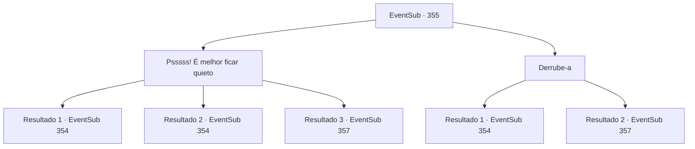

# Eventos secundários · 355

[Índice da tabela](index.md) · [Índice geral](../index.md)

ID: `pt:EventSub:355` · Fonte: `EventSub4` · Versão: 1.2.47.

Mapeamento estático dos arquivos; a disponibilidade e a execução dependem do estado da run.

## Texto do evento

*Sem texto no arquivo.*

## Dados de entrada

```json
{
  "id": 355,
  "grade": 1,
  "subEvent": "",
  "required": ""
}
```

## Mapa das escolhas



## Escolhas e resultados

### Escolha 1

Psssss! É melhor ficar quieto

Requisitos e outros campos da escolha:

```json
{
  "required": ""
}
```

#### Resultado 1.1

A empregada aterrorizada desmaia diante da sua ameaça. Após silenciá-la com sucesso, você segue para outro cômodo. Neste cômodo, há estantes de livros ao longo da parede e peles de veado no chão. Você nota um retrato de Amakar e uma mulher pendurado na parede. Parece ser o escritório de Amakar. Agora você precisa descobrir onde o Jewel of Life está escondido.

Continuação registrada: [Evento 354](0354.md) na mesma tabela.

```json
{
  "required": "",
  "chance": "1|0_12_1",
  "nextEvent": 354,
  "type": 0,
  "reward": ""
}
```

#### Resultado 1.2

A empregada aterrorizada desmaia diante da sua ameaça. Após silenciá-la com sucesso, você segue para outro cômodo. Neste cômodo, há estantes de livros ao longo da parede e peles de veado no chão. Você nota um retrato de Amakar e uma mulher pendurado na parede. Parece ser o escritório de Amakar. Agora você precisa descobrir onde o Jewel of Life está escondido.

Continuação registrada: [Evento 354](0354.md) na mesma tabela.

```json
{
  "required": "20_1_2",
  "chance": "1|0_12_1",
  "nextEvent": 354,
  "type": 0,
  "reward": ""
}
```

#### Resultado 1.3

A empregada solta um grito agudo diante da sua ameaça. Ao ouvir esse som, um guarda próximo corre até você. 

 "O que está acontecendo!"

 Ele saca sua espada e te ataca.

Continuação registrada: [Evento 357](0357.md) na mesma tabela.

```json
{
  "required": "",
  "chance": "18",
  "nextEvent": 357,
  "type": 1,
  "reward": "6_0_135",
  "place": 10
}
```

### Escolha 2

Derrube-a

Requisitos e outros campos da escolha:

```json
{
  "required": ""
}
```

#### Resultado 2.1

Você corre até lá e dá um tapa no queixo da empregada, para nocauteá-la. Você cuidadosamente coloca a empregada inconsciente na cama. Depois de silenciá-la com sucesso, você vai para outro quarto. Neste quarto, há todo tipo de estantes ao longo da parede e peles de veado no chão. Você nota um retrato de Amakar e uma mulher, pendurado na parede. Parece ser o escritório de Amakar. Agora você precisa descobrir onde o Jewel of Life está escondido.

Continuação registrada: [Evento 354](0354.md) na mesma tabela.

```json
{
  "required": "",
  "chance": "1|0_5_1|0_6_1",
  "nextEvent": 354,
  "type": 0,
  "reward": ""
}
```

#### Resultado 2.2

Você corre até lá e dá um tapa no queixo da empregada, na tentativa de nocauteá-la. No entanto, seu plano falha e a empregada solta um grito agudo. Ao ouvir esse som, um guarda próximo corre até lá. 

 "O que está acontecendo!"

 Ele saca sua espada e te ataca.

Continuação registrada: [Evento 357](0357.md) na mesma tabela.

```json
{
  "required": "",
  "chance": "26",
  "nextEvent": 357,
  "type": 1,
  "reward": "6_0_135",
  "place": 10
}
```

## Referências que chegam a este evento

- [Evento 353 · escolha 1 · resultado 2](0353.md#escolha-1)
- [Evento 353 · escolha 1 · resultado 3](0353.md#escolha-1)
- [Evento 353 · escolha 3 · resultado 3](0353.md#escolha-3)
