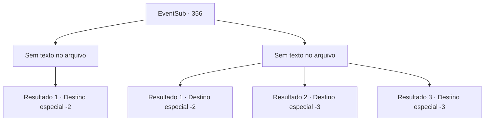

# Eventos secundários · 356

[Índice da tabela](index.md) · [Índice geral](../index.md)

ID: `pt:EventSub:356` · Fonte: `EventSub4` · Versão: 1.2.47.

Mapeamento estático dos arquivos; a disponibilidade e a execução dependem do estado da run.

## Texto do evento

*Sem texto no arquivo.*

## Dados de entrada

```json
{
  "id": 356,
  "grade": 1,
  "subEvent": "",
  "required": ""
}
```

## Mapa das escolhas



## Escolhas e resultados

### Escolha 1

*Sem texto no arquivo; o papel dessa opção depende da interface do jogo.*

Requisitos e outros campos da escolha:

```json
{
  "required": ""
}
```

#### Resultado 1.1


 "Isso não pode estar acontecendo..."

 Você liderou um pequeno grupo de druidas contra os guardas. Sobrecarregados pelo seu imenso poder, eles começam a recuar. 

 "Não tenham medo! Cerquem-nos e ataquem todos de uma vez!"

 Amakar, que grita alto para reunir seus soldados, transforma-se em um enorme urso e parte para cima de você. E então, um sinalizador é disparado da mansão de Amakar. 

 "É hora. Vamos!"

 O druida, que se transformou em uma árvore andante, puxa algo de debaixo dos caules e provoca uma explosão. Uma densa fumaça se ergue, escondendo você e os druidas. 

 "Por aqui!"

 Você e os druidas rompem o cerco e escapam de Tomant. Depois de correr por um tempo e se esconder na floresta, eles lhe dão tapinhas no ombro. 

 "Devemos o sucesso de hoje a você. Obrigado. Certifique-se de visitar a Floresta Silocient mais tarde."

 Eles curam suas feridas e depois partem para a Floresta Silocient.

Continuação registrada: [Destino especial `-2`](../destinos-especiais.md).

```json
{
  "required": "",
  "chance": "1",
  "nextEvent": -2,
  "type": 2,
  "reward": "12_8_5|5_327_1"
}
```

### Escolha 2

*Sem texto no arquivo; o papel dessa opção depende da interface do jogo.*

Requisitos e outros campos da escolha:

```json
{
  "required": ""
}
```

#### Resultado 2.1

Você desaba no chão ao machucar sua perna. Os soldados que te cercam estão se aproximando cada vez mais. Então, um sinalizador da mansão de Amakar cruza o céu. 

 "É hora. Vamos embora!"

 O druida, que se transformou em um treant, puxa algo de baixo dos caules e provoca uma explosão. Uma fumaça espessa sobe, escondendo você e os druidas. 

 "Por aqui!"

 Você e os druidas rompem o cerco e escapam de Tomant. Depois de correr por um tempo e se esconder na floresta, eles te dão tapinhas no ombro. 

 "Agradecemos o sucesso de hoje a você. Obrigado. Não deixe de visitar a Floresta de Silocient mais tarde."

 Eles curam suas feridas e partem para a floresta de Silocient.

Continuação registrada: [Destino especial `-2`](../destinos-especiais.md).

```json
{
  "required": "1_0_2|1_1_2",
  "chance": "1",
  "nextEvent": -2,
  "type": 2,
  "reward": "0_0_-1|0_1_-1|12_8_5|5_327_1"
}
```

#### Resultado 2.2

Uma lança surge do nada, perfurando o seu lado. Sangue escarlate escorre de seus lábios. Você perde o equilíbrio e cai no chão.

Continuação registrada: [Destino especial `-3`](../destinos-especiais.md).

```json
{
  "required": "2_0_2",
  "chance": "1",
  "nextEvent": -3,
  "type": 2,
  "reward": "0_0_-1|0_1_-1"
}
```

#### Resultado 2.3

Uma lança surge do nada, perfurando o seu lado. Sangue escarlate escorre de seus lábios. Você perde o equilíbrio e cai no chão.

Continuação registrada: [Destino especial `-3`](../destinos-especiais.md).

```json
{
  "required": "2_1_2",
  "chance": "1",
  "nextEvent": -3,
  "type": 2,
  "reward": "0_0_-1|0_1_-1"
}
```

## Referências que chegam a este evento

- [Evento 352 · escolha 1 · resultado 1](0352.md#escolha-1)
- [Evento 352 · escolha 2 · resultado 1](0352.md#escolha-2)
