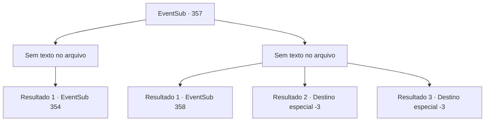

# Eventos secundários · 357

[Índice da tabela](index.md) · [Índice geral](../index.md)

ID: `pt:EventSub:357` · Fonte: `EventSub4` · Versão: 1.2.47.

Mapeamento estático dos arquivos; a disponibilidade e a execução dependem do estado da run.

## Texto do evento

*Sem texto no arquivo.*

## Dados de entrada

```json
{
  "id": 357,
  "grade": 1,
  "subEvent": "",
  "required": ""
}
```

## Mapa das escolhas



## Escolhas e resultados

### Escolha 1

*Sem texto no arquivo; o papel dessa opção depende da interface do jogo.*

Requisitos e outros campos da escolha:

```json
{
  "required": ""
}
```

#### Resultado 1.1

Você nocauteia o guarda e segue para outra sala. Nesta sala, há todo tipo de estante ao longo da parede e peles de veado no chão. Você nota um retrato de Amakar e uma mulher, pendurado na parede. Parece ser o escritório de Amakar. Agora você precisa descobrir onde o Jewel of Life está escondido.

Continuação registrada: [Evento 354](0354.md) na mesma tabela.

```json
{
  "required": "",
  "chance": "1",
  "nextEvent": 354,
  "type": 2,
  "reward": ""
}
```

### Escolha 2

*Sem texto no arquivo; o papel dessa opção depende da interface do jogo.*

Requisitos e outros campos da escolha:

```json
{
  "required": ""
}
```

#### Resultado 2.1

O guarda te derruba e levanta sua espada, apontando-a para o seu pescoço. Logo antes de sua espada perfurar sua garganta, uma águia surge e o empurra para longe. O guarda desmaia após bater a cabeça na parede, e a águia se transforma em sua forma original. Syannathel, agora humana, pega sua mão e te ajuda a se levantar. 

 "Vamos logo. Se aquele não voltar, os outros guardas vão suspeitar."

 Com ela, você abre a porta para outro quarto. No quarto, há todo tipo de estante ao longo da parede e peles de veado no chão. Você nota um retrato de Amakar e uma mulher, pendurados na parede. 

 "Este deve ser o quarto do traidor. A joia deve estar aqui."

 Syannathel franze a testa e começa a examinar cada canto e fresta. Depois de um tempo, ela olha para uma estante e abre a boca. 

 "Há algo estranho nesta estante... Você poderia movê-la, por favor?"


Continuação registrada: [Evento 358](0358.md) na mesma tabela.

```json
{
  "required": "1_0_2|1_1_2",
  "chance": "1",
  "nextEvent": 358,
  "type": 2,
  "reward": "0_0_-1|0_1_-1"
}
```

#### Resultado 2.2

A espada do guarda penetra em seu peito. Você desmaia de agonia e então desaba.

Continuação registrada: [Destino especial `-3`](../destinos-especiais.md).

```json
{
  "required": "2_0_2",
  "chance": "1",
  "nextEvent": -3,
  "type": 2,
  "reward": "0_0_-1|0_1_-1"
}
```

#### Resultado 2.3

A espada do guarda penetra em seu peito. Você desmaia de agonia e então desaba.

Continuação registrada: [Destino especial `-3`](../destinos-especiais.md).

```json
{
  "required": "2_1_2",
  "chance": "1",
  "nextEvent": -3,
  "type": 2,
  "reward": "0_0_-1|0_1_-1"
}
```

## Referências que chegam a este evento

- [Evento 355 · escolha 1 · resultado 3](0355.md#escolha-1)
- [Evento 355 · escolha 2 · resultado 2](0355.md#escolha-2)
