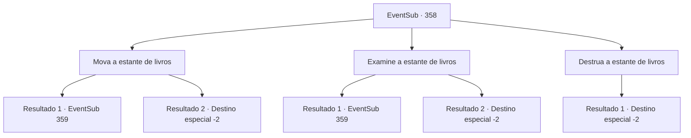

# Eventos secundários · 358

[Índice da tabela](index.md) · [Índice geral](../index.md)

ID: `pt:EventSub:358` · Fonte: `EventSub4` · Versão: 1.2.47.

Mapeamento estático dos arquivos; a disponibilidade e a execução dependem do estado da run.

## Texto do evento

*Sem texto no arquivo.*

## Dados de entrada

```json
{
  "id": 358,
  "grade": 1,
  "subEvent": "",
  "required": ""
}
```

## Mapa das escolhas



## Escolhas e resultados

### Escolha 1

Mova a estante de livros

Requisitos e outros campos da escolha:

```json
{
  "required": ""
}
```

#### Resultado 1.1

Você estica seus músculos e levanta a estante de livros. À medida que o chão racha, os parafusos profundamente embutidos saltam para fora. Você remove a estante de livros e descobre um espaço escondido. A pequena sala está quase vazia, exceto por uma prateleira de madeira e uma gema amarela colocada sobre ela. A joia está pulsando por conta própria, emitindo um calor misterioso. Você pega a Joia da Vida e sai da sala.

Continuação registrada: [Evento 359](0359.md) na mesma tabela.

```json
{
  "required": "",
  "chance": "1|0_5_1",
  "nextEvent": 359,
  "type": 0,
  "reward": "12_8_5|5_327_1"
}
```

#### Resultado 1.2

Você estica seus músculos e tenta levantar a estante de livros. No entanto, parece estar fixa no chão e não se move. Nesse momento, a porta se abre violentamente e Amakar entra correndo. 

 "Você...! Syannathel!"

 Ruborizando o rosto de raiva, ele se transforma em um urso gigante. Syannathel também se transforma em uma águia. Ela te agarra com suas garras e voa para fora da janela. 

 "Os homens dele virão atrás de nós... Não temos escolha a não ser fugir."

 Flechas passam raspando por você e Syannathel, mas eventualmente vocês saem de Tomant em segurança. Após escaparem da cidade, ela luta para abrir a boca, com uma expressão pesada no rosto. 

 "...Obrigada por ajudar, de qualquer forma. Bem, então."

 Se despedindo com uma voz fraca, Syannathel desaparece no céu.

Continuação registrada: [Destino especial `-2`](../destinos-especiais.md).

```json
{
  "required": "",
  "chance": "26",
  "nextEvent": -2,
  "type": 1,
  "reward": "12_8_6"
}
```

### Escolha 2

Examine a estante de livros

Requisitos e outros campos da escolha:

```json
{
  "required": ""
}
```

#### Resultado 2.1

Investigando a estante de livros, você nota um livro com uma capa especialmente desgastada. Você retira o livro e a estante de livros se move revelando um espaço oculto. O pequeno quarto está quase vazio, exceto por uma prateleira de madeira e uma gema amarela colocada sobre ela. A joia está pulsando por si só, emitindo um calor misterioso. Você pega a Joia da Vida e sai do quarto.

Continuação registrada: [Evento 359](0359.md) na mesma tabela.

```json
{
  "required": "",
  "chance": "1|0_14_1",
  "nextEvent": 359,
  "type": 0,
  "reward": "12_8_5|5_327_1"
}
```

#### Resultado 2.2

Você olha pela estante de livros e percebe algo estranho. Mas infelizmente, sua investigação demorou muito. A porta se abre violentamente e Amakar entra correndo. 

 "Você...! Syannathel!"

 Ruborizando o rosto de raiva, ele se transforma em um urso gigante. Syannathel também se transforma em uma águia. Ela te agarra com suas garras e voa para fora da janela. 

 "Os homens dele virão atrás de nós... Não temos escolha a não ser fugir."

 Flechas passam raspando por você e Syannathel, mas eventualmente vocês saem de Tomant em segurança. Após escaparem da cidade, ela luta para abrir a boca, com uma expressão pesada no rosto. 

 "...Obrigada por ajudar, de qualquer forma. Bem, então."

 Se despedindo com uma voz fraca, Syannathel desaparece no céu.

Continuação registrada: [Destino especial `-2`](../destinos-especiais.md).

```json
{
  "required": "",
  "chance": "22",
  "nextEvent": -2,
  "type": 1,
  "reward": "12_8_6"
}
```

### Escolha 3

Destrua a estante de livros

Requisitos e outros campos da escolha:

```json
{
  "required": ""
}
```

#### Resultado 3.1


 "O que você está fazendo..!"

 Ignorando a preocupação de Syannathel, você tenta destruir a estante de livros balançando sua arma. Mas infelizmente, sua investigação foi muito barulhenta. A porta se abre violentamente e Amakar entra correndo. 

 "Você..! Syannathel!"

 Com o rosto vermelho de raiva, ele se transforma em um urso gigante. Syannathel também se transforma em uma águia. Ela te agarra com suas garras e voa pela janela. 

 "Os homens dele virão atrás de nós... Não temos escolha a não ser fugir."

 Flechas passam raspando por você e Syannathel, mas eventualmente vocês conseguem sair de Tomant em segurança. Após escaparem da cidade, ela luta para abrir a boca, com uma expressão pesada no rosto. 

 "...Obrigada por ajudar, de qualquer forma. Bem, então."

 Se despedindo com uma voz fraca, Syannathel desaparece no céu.

Continuação registrada: [Destino especial `-2`](../destinos-especiais.md).

```json
{
  "required": "",
  "chance": "1",
  "nextEvent": -2,
  "type": 2,
  "reward": "12_8_6"
}
```

## Referências que chegam a este evento

- [Evento 357 · escolha 2 · resultado 1](0357.md#escolha-2)
