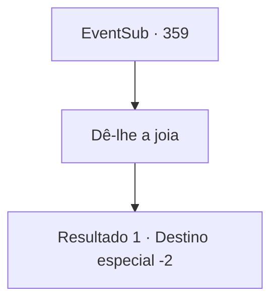

# Eventos secundários · 359

[Índice da tabela](index.md) · [Índice geral](../index.md)

ID: `pt:EventSub:359` · Fonte: `EventSub4` · Versão: 1.2.47.

Mapeamento estático dos arquivos; a disponibilidade e a execução dependem do estado da run.

## Texto do evento

*Sem texto no arquivo.*

## Dados de entrada

```json
{
  "id": 359,
  "grade": 1,
  "subEvent": "",
  "required": ""
}
```

## Mapa das escolhas



## Escolhas e resultados

### Escolha 1

Dê-lhe a joia

Requisitos e outros campos da escolha:

```json
{
  "required": ""
}
```

#### Resultado 1.1

Syannathel, radiante de exaltação, guarda a joia. 

 "Finalmente... Recuperamos a joia. Melhor fugir rapidamente agora. Não se esqueça de sinalizar antes disso."

 Você dispara o sinalizador assim que ela diz, e os dois escapam de Tomant juntos. 

 "Agradeço profundamente pela sua ajuda. Por favor, nos visite novamente mais tarde. Nós iremos recompensá-lo com um presente esplêndido."

 Ela agradece e parte.

Continuação registrada: [Destino especial `-2`](../destinos-especiais.md).

```json
{
  "required": "",
  "chance": "1",
  "nextEvent": -2,
  "type": 2,
  "reward": "4_239_1|4_54_1"
}
```

## Referências que chegam a este evento

- [Evento 354 · escolha 1 · resultado 1](0354.md#escolha-1)
- [Evento 354 · escolha 2 · resultado 1](0354.md#escolha-2)
- [Evento 358 · escolha 1 · resultado 1](0358.md#escolha-1)
- [Evento 358 · escolha 2 · resultado 1](0358.md#escolha-2)
