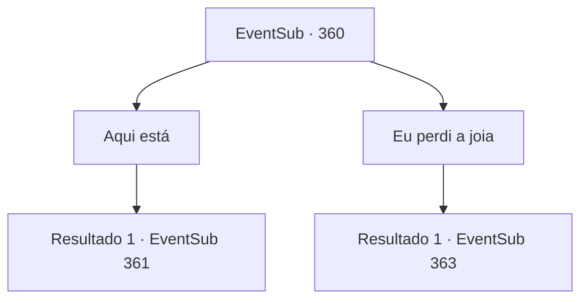

# Eventos secundários · 360

[Índice da tabela](index.md) · [Índice geral](../index.md)

ID: `pt:EventSub:360` · Fonte: `EventSub4` · Versão: 1.2.47.

Mapeamento estático dos arquivos; a disponibilidade e a execução dependem do estado da run.

## Texto do evento

Você chega na Floresta Silociente e percebe uma atmosfera agitada. Os druidas, reunidos em um só lugar, estão falando alto. Conforme você se aproxima, Syannathel olha para trás e pergunta. 

 "Como foi? Onde está a Jóia da Vida?"


## Dados de entrada

```json
{
  "id": 360,
  "grade": 1,
  "subEvent": "",
  "required": "12_8_3"
}
```

## Mapa das escolhas



## Escolhas e resultados

### Escolha 1

Aqui está

Requisitos e outros campos da escolha:

```json
{
  "required": "8_239_1"
}
```

#### Resultado 1.1

Você tira a joia da sua mochila e entrega-a. Syannathel anuncia aos druidas. 

 "Todos! {1} recuperou nossa joia!"

 Os druidas, que estavam preparando um ritual, correm em sua direção e gritam vivas calorosos. Alguns deles até se emocionam. 

 "Muito obrigado, aventureiro. Eu gostaria muito de lhe oferecer um presente em troca. O que você tem em mente?"


Continuação registrada: [Evento 361](0361.md) na mesma tabela.

```json
{
  "required": "",
  "chance": "1",
  "nextEvent": 361,
  "type": 2,
  "reward": "4_239_1"
}
```

### Escolha 2

Eu perdi a joia

Requisitos e outros campos da escolha:

```json
{
  "required": "10_239_1"
}
```

#### Resultado 2.1

Os druidas congelam com suas palavras. 

 "Aquilo não poderia... Deve ser mentira, certo?"

 Syannathel pergunta com voz trêmula. Você abre sua mochila para mostrar a ela que perdeu a joia. De maneira intimidadora, ela se aproxima e te ataca.

Continuação registrada: [Evento 363](0363.md) na mesma tabela.

```json
{
  "required": "",
  "chance": "1",
  "nextEvent": 363,
  "type": 2,
  "reward": "6_3_139",
  "place": 1
}
```

## Referências que chegam a este evento

Nenhum `nextEvent` positivo da mesma tabela aponta para este nó. Isso não prova que seja inacessível: sorteio e estado de história podem selecioná-lo.

