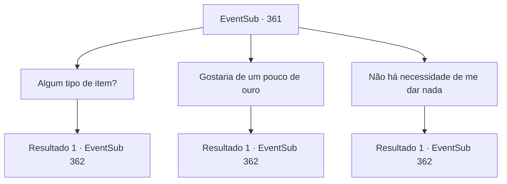

# Eventos secundários · 361

[Índice da tabela](index.md) · [Índice geral](../index.md)

ID: `pt:EventSub:361` · Fonte: `EventSub4` · Versão: 1.2.47.

Mapeamento estático dos arquivos; a disponibilidade e a execução dependem do estado da run.

## Texto do evento

*Sem texto no arquivo.*

## Dados de entrada

```json
{
  "id": 361,
  "grade": 1,
  "subEvent": "",
  "required": ""
}
```

## Mapa das escolhas



## Escolhas e resultados

### Escolha 1

Algum tipo de item?

Requisitos e outros campos da escolha:

```json
{
  "required": ""
}
```

#### Resultado 1.1

Você decide que um item de valor faria. Ao ouvir isso, Syannathel traz uma varinha que emite uma fragrância doce e entrega a você. 

 "É uma equipe, elaborada por galhos de árvore de flores de ameixa. É o único que resta, mas você merece ter, aventureiro."

 Depois de lhe dar a varinha, ela participa do ritual, juntamente com os outros druidas. Você não pode deixar de encarar isso pasmo, o ritual que é tão majestoso e santo. |drawing_DruidRitual| Depois de algum tempo se passou, o ritual termina. Os druidas seguram um pequeno festival. Segundo eles, é uma festa celebrar como a floresta florescerá novamente. Você decide se juntar ao festival e se divertir.

Continuação registrada: [Evento 362](0362.md) na mesma tabela.

```json
{
  "required": "",
  "chance": "1",
  "nextEvent": 362,
  "type": 2,
  "reward": "3_240_1"
}
```

### Escolha 2

Gostaria de um pouco de ouro

Requisitos e outros campos da escolha:

```json
{
  "required": ""
}
```

#### Resultado 2.1

Você decide que o ouro faria. Ao ouvir isso, Syannathel traz uma pequena bolsa feita de folhas e entrega a você. 

 "Não é muito, mas é tudo o que temos. Obrigada."

 Ela então retorna ao ritual com os outros druidas. Você não pode deixar de encarar isso pasmo, o ritual que é tão majestoso e santo. |drawing_DruidRitual| Depois de algum tempo se passou, o ritual termina. Os druidas seguram um pequeno festival. Segundo eles, é uma festa celebrar como a floresta florescerá novamente. Você decide se juntar ao festival e se divertir.

Continuação registrada: [Evento 362](0362.md) na mesma tabela.

```json
{
  "required": "",
  "chance": "1",
  "nextEvent": 362,
  "type": 2,
  "reward": "0_4_60"
}
```

### Escolha 3

Não há necessidade de me dar nada

Requisitos e outros campos da escolha:

```json
{
  "required": ""
}
```

#### Resultado 3.1

Você diz a ela que ela não precisa se sentir obrigada. Todos os druidas olham para você com olhos brilhantes e brilhantes. 

 "Obrigado, aventureiro. Não vamos esquecer o que você fez pela nossa floresta."

 Os druidas então retornam ao seu ritual. Você não pode deixar de encarar isso pasmo, o ritual que é tão majestoso e santo. |drawing_DruidRitual| Depois de algum tempo se passou, o ritual termina. Os druidas seguram um pequeno festival. Segundo eles, é uma festa celebrar como a floresta florescerá novamente. Você decide se juntar ao festival e se divertir.

Continuação registrada: [Evento 362](0362.md) na mesma tabela.

```json
{
  "required": "",
  "chance": "1",
  "nextEvent": 362,
  "type": 2,
  "reward": "0_3_5"
}
```

## Referências que chegam a este evento

- [Evento 360 · escolha 1 · resultado 1](0360.md#escolha-1)
