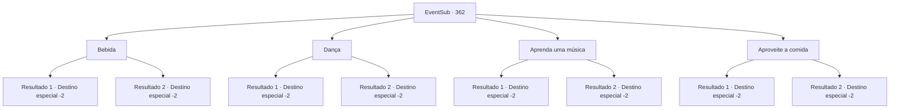

# Eventos secundários · 362

[Índice da tabela](index.md) · [Índice geral](../index.md)

ID: `pt:EventSub:362` · Fonte: `EventSub4` · Versão: 1.2.47.

Mapeamento estático dos arquivos; a disponibilidade e a execução dependem do estado da run.

## Texto do evento

*Sem texto no arquivo.*

## Dados de entrada

```json
{
  "id": 362,
  "grade": 1,
  "subEvent": "",
  "required": ""
}
```

## Mapa das escolhas



## Escolhas e resultados

### Escolha 1

Bebida

Requisitos e outros campos da escolha:

```json
{
  "required": ""
}
```

#### Resultado 1.1

Você bebe e vê a festa se desenrolar. O vinho de frutas tradicional dos druidas tem um sabor doce. Você se sente mais feliz do que nunca. Syannathel se senta ao seu lado e conta uma história sobre o vinho. 

 "Esse é um vinho de frutas douradas. Aparentemente, sua cabeça fica cheia de sabedoria depois de terminá-lo! Ou é apenas a ressaca. Heehee..."

 Você aproveita mais um pouco de vinho, conversando com Syannathel, cujo rosto está cheio de um sorriso feliz. Na manhã seguinte, você acorda se sentindo revigorado e se despede dos druidas.

Continuação registrada: [Destino especial `-2`](../destinos-especiais.md).

```json
{
  "required": "",
  "chance": "1|0_14_1",
  "nextEvent": -2,
  "type": 0,
  "reward": "0_2_1|0_14_1|12_8_5"
}
```

#### Resultado 1.2

Você bebe e vê a festa se desenrolar. O vinho de frutas tradicional dos druidas tem um sabor doce. Você se sente mais feliz do que nunca. Syannathel se senta ao seu lado e conta uma história sobre o vinho. 

 "Esse é um vinho de frutas douradas. Aparentemente, sua cabeça fica cheia de sabedoria depois de terminá-lo! Ou é apenas a ressaca. Heehee..."

 Você aproveita mais um pouco de vinho, conversando com Syannathel, cujo rosto está cheio de um sorriso feliz. Na manhã seguinte, você acorda com uma dor de cabeça terrível e se despede dos druidas.

Continuação registrada: [Destino especial `-2`](../destinos-especiais.md).

```json
{
  "required": "",
  "chance": "11",
  "nextEvent": -2,
  "type": 1,
  "reward": "12_8_5"
}
```

### Escolha 2

Dança

Requisitos e outros campos da escolha:

```json
{
  "required": ""
}
```

#### Resultado 2.1

Você aproveita a festa dançando. A música tradicional dos druidas conseguiu despertar a musa dentro de você. Syannathel se aproxima de você e te toca no ombro. 

 "Belos movimentos que você tem. Gostaria de aprender nossa dança tradicional, talvez?"

 Você passa a noite dançando com ela. Na manhã seguinte, você se despede dos druidas, com as memórias da dança ainda fixas em sua mente.

Continuação registrada: [Destino especial `-2`](../destinos-especiais.md).

```json
{
  "required": "",
  "chance": "1|0_6_1",
  "nextEvent": -2,
  "type": 0,
  "reward": "0_2_1|0_6_1|12_8_5"
}
```

#### Resultado 2.2

Você aproveita a festa dançando. A música tradicional dos druidas conseguiu despertar a musa dentro de você. Syannathel se aproxima de você e toca em seu ombro. 

 "Belos movimentos que você tem. Gostaria de aprender nossa dança tradicional, talvez?"

 Você passa a noite dançando com ela. Na manhã seguinte, você acorda se sentindo cansado e se despede dos druidas.

Continuação registrada: [Destino especial `-2`](../destinos-especiais.md).

```json
{
  "required": "",
  "chance": "11",
  "nextEvent": -2,
  "type": 1,
  "reward": "12_8_5"
}
```

### Escolha 3

Aprenda uma música

Requisitos e outros campos da escolha:

```json
{
  "required": ""
}
```

#### Resultado 3.1

Você aproveita a festa cantando. Os hinos tradicionais dos druidas são suficientes para lhe dar algumas inspirações musicais. Syannathel toca seu estômago e lhe ensina algumas músicas. 

 "Dizem que essa música pode trazer a beleza interior de alguém... Vamos lá, coloque um pouco de poder em seu ventre..."

 Você passa a noite cantando a música que ela lhe ensinou. Na manhã seguinte, você se despede dos druidas, ainda cantando a música que aprendeu em sua mente.

Continuação registrada: [Destino especial `-2`](../destinos-especiais.md).

```json
{
  "required": "",
  "chance": "1|0_12_1",
  "nextEvent": -2,
  "type": 0,
  "reward": "0_2_1|0_12_1|12_8_5"
}
```

#### Resultado 3.2

Você aproveita a festa cantando. Os hinos tradicionais dos druidas são suficientes para lhe dar algumas inspirações musicais. Syannathel toca seu estômago e ensina algumas músicas. 

 "Dizem que essa música pode trazer a beleza interior de alguém... Vamos lá, coloque um pouco de poder em seu ventre..."

 Você canta a música que ela te ensinou. Então, ela parece um pouco... surpresa. 

 "Ooh... Parece que você não tem muito talento para cantar..."

 Você decide apenas ouvir os druidas cantando. Na manhã seguinte, você se despede dos druidas.

Continuação registrada: [Destino especial `-2`](../destinos-especiais.md).

```json
{
  "required": "",
  "chance": "11",
  "nextEvent": -2,
  "type": 1,
  "reward": "12_8_5"
}
```

### Escolha 4

Aproveite a comida

Requisitos e outros campos da escolha:

```json
{
  "required": ""
}
```

#### Resultado 4.1

Você decide aproveitar a festa se deliciando com as iguarias dos druidas. Cada um dos alimentos deles parece ter seu próprio sabor e textura únicos. Você pega uma colherada de uma sopa marrom e se surpreende com seu sabor único. Syannathel, sentada ao seu lado, ri e fala. 

 "Você gostou? Chama-se 'Vitalidade do Druida', feito com vermes e centopeias locais. Espero que você ache saboroso. Heehee..."

 Ela acrescenta que é uma refeição difícil de comer para iniciantes. Mas você não tem nenhum problema em comê-la. A festa chega ao fim e você se despede dos druidas, sentindo uma nova fonte de poder crescendo dentro de você.

Continuação registrada: [Destino especial `-2`](../destinos-especiais.md).

```json
{
  "required": "",
  "chance": "1|0_13_1",
  "nextEvent": -2,
  "type": 0,
  "reward": "0_2_1|0_13_1|12_8_5"
}
```

#### Resultado 4.2

Você decide aproveitar a festa se deliciando com as iguarias dos druidas. Cada um dos alimentos deles parece ter seu próprio sabor e textura únicos. Você pega uma colherada de uma sopa marrom e se surpreende com seu sabor único. Syannathel, sentada ao seu lado, ri e fala. 

 "Você gostou? Chama-se 'Vitalidade do Druida', feito com vermes e centopeias locais. Espero que você ache saboroso. Heehee..."

 Ela acrescenta que é uma refeição difícil de comer para iniciantes. Ao ouvir o conteúdo da sopa que você acabou de comer, você vomita imediatamente. Syannathel explode em risos e dá tapinhas nas suas costas. A festa chega ao fim e você se despede dos druidas, ainda se sentindo mal com a sopa de insetos.

Continuação registrada: [Destino especial `-2`](../destinos-especiais.md).

```json
{
  "required": "",
  "chance": "11",
  "nextEvent": -2,
  "type": 1,
  "reward": "12_8_5"
}
```

## Referências que chegam a este evento

- [Evento 361 · escolha 1 · resultado 1](0361.md#escolha-1)
- [Evento 361 · escolha 2 · resultado 1](0361.md#escolha-2)
- [Evento 361 · escolha 3 · resultado 1](0361.md#escolha-3)
