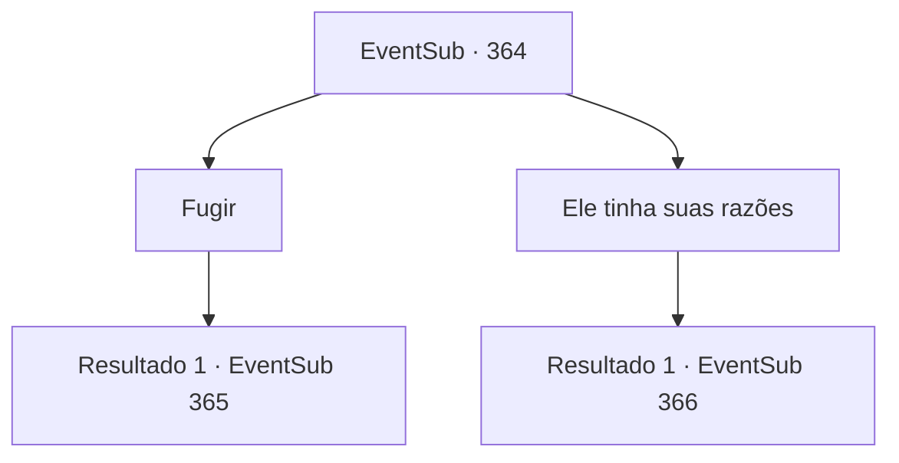

# Eventos secundários · 364

[Índice da tabela](index.md) · [Índice geral](../index.md)

ID: `pt:EventSub:364` · Fonte: `EventSub4` · Versão: 1.2.47.

Mapeamento estático dos arquivos; a disponibilidade e a execução dependem do estado da run.

## Texto do evento

Uma grande sombra cai sobre você. Pouco depois, uma grande águia pousa do céu. Ao sacar sua arma para afugentá-la, você ouve uma voz familiar. 

 "Você deve ter conhecido Amakar. Por que você não voltou para nós?"

 Pela voz irritada, você poderia dizer que é Syannathel.

## Dados de entrada

```json
{
  "id": 364,
  "grade": 1,
  "subEvent": "",
  "required": "12_8_4"
}
```

## Mapa das escolhas



## Escolhas e resultados

### Escolha 1

Fugir

Requisitos e outros campos da escolha:

```json
{
  "required": ""
}
```

#### Resultado 1.1

Você responde à pergunta dela ao se afastar rapidamente. Depois de correr uma boa distância, você prende a respiração por um tempo. De repente, você ouve o choro dela sobre sua cabeça. 

 "Então essa é a sua resposta, traidor...!"

 Num piscar de olhos, a águia mergulha.

Continuação registrada: [Evento 365](0365.md) na mesma tabela.

```json
{
  "required": "",
  "chance": "1",
  "nextEvent": 365,
  "type": 2,
  "reward": "6_0_134",
  "place": 0
}
```

### Escolha 2

Ele tinha suas razões

Requisitos e outros campos da escolha:

```json
{
  "required": ""
}
```

#### Resultado 2.1

Você pede a ela para entender Amakar, já que ele também tinha suas próprias circunstâncias. Syannathel eleva ainda mais a voz. 

 "...Você está tomando o lado dele na minha frente? Ele roubou nosso tesouro e destruiu nossa casa!"


Continuação registrada: [Evento 366](0366.md) na mesma tabela.

```json
{
  "required": "",
  "chance": "1",
  "nextEvent": 366,
  "type": 2,
  "reward": ""
}
```

## Referências que chegam a este evento

Nenhum `nextEvent` positivo da mesma tabela aponta para este nó. Isso não prova que seja inacessível: sorteio e estado de história podem selecioná-lo.

