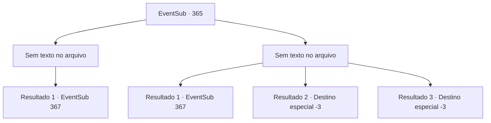

# Eventos secundários · 365

[Índice da tabela](index.md) · [Índice geral](../index.md)

ID: `pt:EventSub:365` · Fonte: `EventSub4` · Versão: 1.2.47.

Mapeamento estático dos arquivos; a disponibilidade e a execução dependem do estado da run.

## Texto do evento

*Sem texto no arquivo.*

## Dados de entrada

```json
{
  "id": 365,
  "grade": 1,
  "subEvent": "",
  "required": ""
}
```

## Mapa das escolhas



## Escolhas e resultados

### Escolha 1

*Sem texto no arquivo; o papel dessa opção depende da interface do jogo.*

Requisitos e outros campos da escolha:

```json
{
  "required": ""
}
```

#### Resultado 1.1

Syannathel, nocauteado por você, se transforma em um pequeno rato e desaparece no subsolo. Logo em seguida, um corvo pousa em seu ombro. Brilhando seus olhos com um brilho verde, o corvo fala em linguagem humana. 

 "...Você pode me ouvir, {1}? Eu sou Amakar. Como você entendeu minha situação, gostaria de lhe pedir um favor."

 Ele afirma que os druidas irão atacar a cidade. Ele previu isso com astrologia. Ele pede que você ajude a defender Tomant contra eles.

Continuação registrada: [Evento 367](0367.md) na mesma tabela.

```json
{
  "required": "",
  "chance": "1",
  "nextEvent": 367,
  "type": 2,
  "reward": ""
}
```

### Escolha 2

*Sem texto no arquivo; o papel dessa opção depende da interface do jogo.*

Requisitos e outros campos da escolha:

```json
{
  "required": ""
}
```

#### Resultado 2.1

No meio da luta, um bando de corvos aparece e cerca a águia. Um dos corvos fica em seu ombro. Brilhando seus olhos com um brilho verde, o corvo fala em linguagem humana. 

 "...Você pode me ouvir, {1}? Eu sou Amakar. Meus familiares vão comprar algum tempo para você fugir."

 Graças a Amakar, você consegue escapar de Syannathel. Enquanto você recupera o fôlego por um momento, Amakar fala com você através de seu corvo novamente. 

 "Já que você entendeu minha situação, gostaria de pedir um favor a você."

 Ele afirma que os druidas vão atacar a cidade. Ele previu isso com astrologia. Ele pede que você ajude a defender Tomant contra eles.

Continuação registrada: [Evento 367](0367.md) na mesma tabela.

```json
{
  "required": "1_0_2|1_1_2",
  "chance": "1",
  "nextEvent": 367,
  "type": 2,
  "reward": "0_0_-1|0_1_-1"
}
```

#### Resultado 2.2

Syannathel, transformada em uma águia, rasga seu pescoço com suas garras afiadas. O vento sopra através do corte e sangue escarlate jorra dele. Você desmaia.

Continuação registrada: [Destino especial `-3`](../destinos-especiais.md).

```json
{
  "required": "2_0_2",
  "chance": "1",
  "nextEvent": -3,
  "type": 2,
  "reward": "0_0_-1|0_1_-1"
}
```

#### Resultado 2.3

Syannathel, transformada em uma águia, rasga seu pescoço com suas garras afiadas. O vento sopra através do corte e sangue escarlate jorra dele. Você desmaia.

Continuação registrada: [Destino especial `-3`](../destinos-especiais.md).

```json
{
  "required": "2_1_2",
  "chance": "1",
  "nextEvent": -3,
  "type": 2,
  "reward": "0_0_-1|0_1_-1"
}
```

## Referências que chegam a este evento

- [Evento 364 · escolha 1 · resultado 1](0364.md#escolha-1)
- [Evento 366 · escolha 2 · resultado 1](0366.md#escolha-2)
