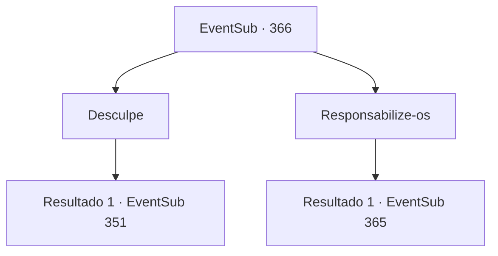

# Eventos secundários · 366

[Índice da tabela](index.md) · [Índice geral](../index.md)

ID: `pt:EventSub:366` · Fonte: `EventSub4` · Versão: 1.2.47.

Mapeamento estático dos arquivos; a disponibilidade e a execução dependem do estado da run.

## Texto do evento

*Sem texto no arquivo.*

## Dados de entrada

```json
{
  "id": 366,
  "grade": 1,
  "subEvent": "",
  "required": ""
}
```

## Mapa das escolhas



## Escolhas e resultados

### Escolha 1

Desculpe

Requisitos e outros campos da escolha:

```json
{
  "required": ""
}
```

#### Resultado 1.1

Percebendo o quão furioso ela está, você implora para que ela o perdoe. Syannathel retorna para uma forma humana. 

 "... eu vou te perdoar pela primeira vez. Ainda há uma chance. Venha conosco para Tomant."

 Você não pode recusar a oferta dela. Você a segue até a floresta silociente. Os druidas reuniram um pergaminho sobre a mesa, tendo uma discussão. É um mapa de Tomant na visão panorâmica de um pássaro. Um druida pergunta onde você esteve, mas Syannathel corta imediatamente. 

 "Melhor retomar a reunião. Se marcharmos de frente, o dano será imenso. Em vez disso, seremos divididos em duas unidades. A primeira unidade atrai atenção, E os outros se infiltram na mansão de Amakar. Enquanto a 'unidade de isca' faz perturbações, a 'unidade de infiltração' recuperará a jóia e enviará um sinal. Se a 'unidade de isca' foge com segurança, chamamos a operação de sucesso."


Continuação registrada: [Evento 351](0351.md) na mesma tabela.

```json
{
  "required": "",
  "chance": "1",
  "nextEvent": 351,
  "type": 2,
  "reward": "5_326_1"
}
```

### Escolha 2

Responsabilize-os

Requisitos e outros campos da escolha:

```json
{
  "required": ""
}
```

#### Resultado 2.1

Você os questiona se eles tinham deixado Amakar de fora desde o início. Syannathel não esconde seu descontentamento.  

 "Ele acabou nos traindo e destruindo nossa floresta, assim como a profecia! O sonho do ancião era verdadeiro."

 Então ela lança suas garras afiadas em sua direção.

Continuação registrada: [Evento 365](0365.md) na mesma tabela.

```json
{
  "required": "",
  "chance": "1",
  "nextEvent": 365,
  "type": 2,
  "reward": "6_0_134",
  "place": 0
}
```

## Referências que chegam a este evento

- [Evento 364 · escolha 2 · resultado 1](0364.md#escolha-2)
