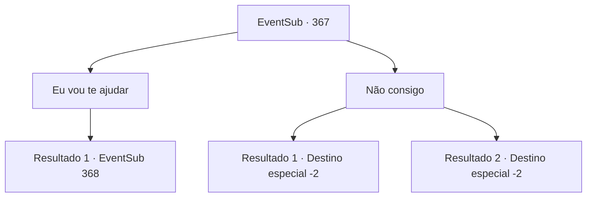

# Eventos secundários · 367

[Índice da tabela](index.md) · [Índice geral](../index.md)

ID: `pt:EventSub:367` · Fonte: `EventSub4` · Versão: 1.2.47.

Mapeamento estático dos arquivos; a disponibilidade e a execução dependem do estado da run.

## Texto do evento

*Sem texto no arquivo.*

## Dados de entrada

```json
{
  "id": 367,
  "grade": 1,
  "subEvent": "",
  "required": ""
}
```

## Mapa das escolhas



## Escolhas e resultados

### Escolha 1

Eu vou te ajudar

Requisitos e outros campos da escolha:

```json
{
  "required": ""
}
```

#### Resultado 1.1

Amakar responde em um tom um pouco excitado. 

 "Obrigada. Por favor, siga meu corvo."

 Quando ele termina de falar, o corvo em seu ombro voa no céu. Ele é croaks como se estivesse guiando o caminho. 

 Depois de alguns dias depois, você chega a Tomant. Você se apressou, mas parece que o ataque dos druidas já começou. Os belos edifícios e as ruas animadas agora estão queimadas e arruinadas. Feras como um lobo, um urso, uma árvore e uma águia, estão atacando pessoas.

Continuação registrada: [Evento 368](0368.md) na mesma tabela.

```json
{
  "required": "",
  "chance": "1",
  "nextEvent": 368,
  "type": 2,
  "reward": ""
}
```

### Escolha 2

Não consigo

Requisitos e outros campos da escolha:

```json
{
  "required": ""
}
```

#### Resultado 2.1

Você recusa o pedido de Amakar. Tentando esconder sua decepção, ele responde. 

 "É mesmo... Que pena. Terei que procurar por outra pessoa..."

 Quando ele termina de falar, o corvo em seu ombro voa para o céu.

Continuação registrada: [Destino especial `-2`](../destinos-especiais.md).

```json
{
  "required": "",
  "chance": "1",
  "nextEvent": -2,
  "type": 2,
  "reward": "12_8_10"
}
```

#### Resultado 2.2

Você recusa o pedido de Amakar. Tentando esconder sua decepção, ele responde. 

 "É mesmo... Que pena. Terei que procurar por outra pessoa..."

 Quando ele termina de falar, o corvo em seu ombro voa para o céu.

Continuação registrada: [Destino especial `-2`](../destinos-especiais.md).

```json
{
  "required": "",
  "chance": "1",
  "nextEvent": -2,
  "type": 2,
  "reward": "12_8_11"
}
```

## Referências que chegam a este evento

- [Evento 365 · escolha 1 · resultado 1](0365.md#escolha-1)
- [Evento 365 · escolha 2 · resultado 1](0365.md#escolha-2)
