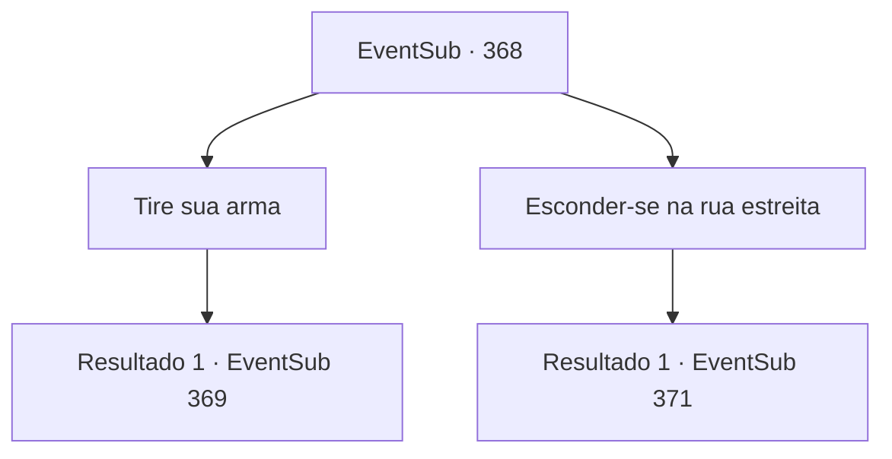

# Eventos secundários · 368

[Índice da tabela](index.md) · [Índice geral](../index.md)

ID: `pt:EventSub:368` · Fonte: `EventSub4` · Versão: 1.2.47.

Mapeamento estático dos arquivos; a disponibilidade e a execução dependem do estado da run.

## Texto do evento

*Sem texto no arquivo.*

## Dados de entrada

```json
{
  "id": 368,
  "grade": 1,
  "subEvent": "",
  "required": ""
}
```

## Mapa das escolhas



## Escolhas e resultados

### Escolha 1

Tire sua arma

Requisitos e outros campos da escolha:

```json
{
  "required": ""
}
```

#### Resultado 1.1

Você puxa sua arma e se junta à luta. Um lobo especialmente grande solta um sopro frio em sua direção.

Continuação registrada: [Evento 369](0369.md) na mesma tabela.

```json
{
  "required": "",
  "chance": "1",
  "nextEvent": 369,
  "type": 2,
  "reward": "6_0_88",
  "place": 4
}
```

### Escolha 2

Esconder-se na rua estreita

Requisitos e outros campos da escolha:

```json
{
  "required": "1_14_12"
}
```

#### Resultado 2.1

Você se apressa em um beco escuro. Todo lugar da cidade é como um campo de batalha, mas, felizmente, esse beco está deserto. Nesse momento, você vê Syannathel em direção à mansão do proprietário. Você a segura. Quando você chega à mansão, os soldados e os druidas estão lutando ferozmente no quintal. Você vai passar por eles. Entrando na mansão, você se depara com duas pessoas se enfrentando. Um é Amakar, e o outro é Syannathel. |drawing_duelDruid| Amakar vê você e grita. 

 "Por favor me ajude, {1}! Devemos proteger a jóia!"

 No momento em que você dá um passo para atacar Syannathel, o chão racha sob os pés e as raízes das árvores. Eles estão prestes a enrolar ao seu redor.

Continuação registrada: [Evento 371](0371.md) na mesma tabela.

```json
{
  "required": "",
  "chance": "1",
  "nextEvent": 371,
  "type": 2,
  "reward": ""
}
```

## Referências que chegam a este evento

- [Evento 367 · escolha 1 · resultado 1](0367.md#escolha-1)
