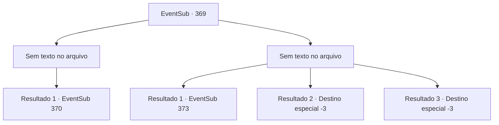

# Eventos secundários · 369

[Índice da tabela](index.md) · [Índice geral](../index.md)

ID: `pt:EventSub:369` · Fonte: `EventSub4` · Versão: 1.2.47.

Mapeamento estático dos arquivos; a disponibilidade e a execução dependem do estado da run.

## Texto do evento

*Sem texto no arquivo.*

## Dados de entrada

```json
{
  "id": 369,
  "grade": 1,
  "subEvent": "",
  "required": ""
}
```

## Mapa das escolhas



## Escolhas e resultados

### Escolha 1

*Sem texto no arquivo; o papel dessa opção depende da interface do jogo.*

Requisitos e outros campos da escolha:

```json
{
  "required": ""
}
```

#### Resultado 1.1

Você derrota o lobo enfurecido e recupera o fôlego por um momento. Há fogo aqui e ali, e as bestas estão indo para algum lugar, rompendo o cerco. Os soldados desabam impotentes como folhas no vendaval. Então, um soldado fala com você com a voz trêmula. 

 "Urgh... por favor... me ajude. Aqueles bárbaros estão atrás do senhor Amakar."


Continuação registrada: [Evento 370](0370.md) na mesma tabela.

```json
{
  "required": "",
  "chance": "1",
  "nextEvent": 370,
  "type": 2,
  "reward": ""
}
```

### Escolha 2

*Sem texto no arquivo; o papel dessa opção depende da interface do jogo.*

Requisitos e outros campos da escolha:

```json
{
  "required": ""
}
```

#### Resultado 2.1

Você congela com o sopro do lobo de inverno. Quando recupera a consciência, a batalha já acabou. Você abre os olhos em um hospital de campanha. Ao se levantar, Amakar se aproxima e fala com você. 

 "Como você está se sentindo?"


Continuação registrada: [Evento 373](0373.md) na mesma tabela.

```json
{
  "required": "1_0_2|1_1_2",
  "chance": "1",
  "nextEvent": 373,
  "type": 2,
  "reward": "0_0_-1|0_1_-1"
}
```

#### Resultado 2.2

A boca do lobo do inverno morde toda a sua cabeça. Incapaz de resistir, você sucumbe à sua morte.

Continuação registrada: [Destino especial `-3`](../destinos-especiais.md).

```json
{
  "required": "2_0_2",
  "chance": "1",
  "nextEvent": -3,
  "type": 2,
  "reward": "0_0_-1|0_1_-1"
}
```

#### Resultado 2.3

A boca do lobo do inverno morde toda a sua cabeça. Incapaz de resistir, você sucumbe à sua morte.

Continuação registrada: [Destino especial `-3`](../destinos-especiais.md).

```json
{
  "required": "2_1_2",
  "chance": "1",
  "nextEvent": -3,
  "type": 2,
  "reward": "0_0_-1|0_1_-1"
}
```

## Referências que chegam a este evento

- [Evento 368 · escolha 1 · resultado 1](0368.md#escolha-1)
