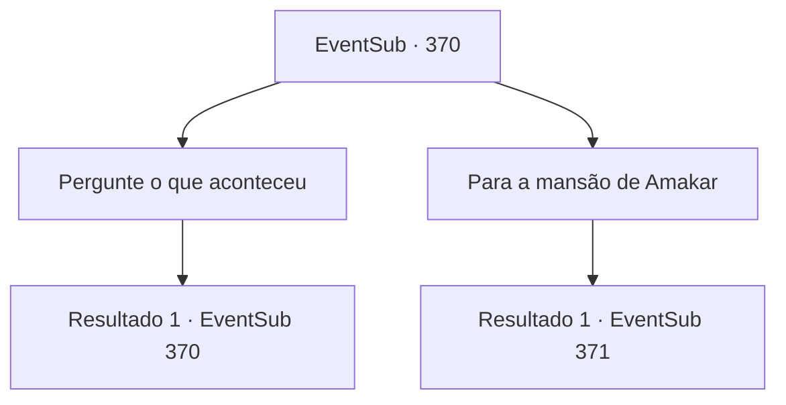

# Eventos secundários · 370

[Índice da tabela](index.md) · [Índice geral](../index.md)

ID: `pt:EventSub:370` · Fonte: `EventSub4` · Versão: 1.2.47.

Mapeamento estático dos arquivos; a disponibilidade e a execução dependem do estado da run.

## Texto do evento

*Sem texto no arquivo.*

## Dados de entrada

```json
{
  "id": 370,
  "grade": 1,
  "subEvent": "",
  "required": ""
}
```

## Mapa das escolhas



## Escolhas e resultados

### Escolha 1

Pergunte o que aconteceu

Requisitos e outros campos da escolha:

```json
{
  "required": "5_328_0"
}
```

#### Resultado 1.1

O soldado responde à sua pergunta com dificuldade. 

 "Eles envenenaram o poço... Desde alguns dias atrás, o número de soldados doentes aumentou repentinamente. Naquela época, eu não fazia ideia, mas agora acho que sei a resposta."

 De acordo com ele, a maioria dos soldados sofria de dor de estômago, e por isso não conseguiam lidar adequadamente com o ataque dos druidas.

Continuação registrada: [Evento 370](0370.md) na mesma tabela.

```json
{
  "required": "",
  "chance": "1",
  "nextEvent": 370,
  "type": 2,
  "reward": "5_328_1"
}
```

### Escolha 2

Para a mansão de Amakar

Requisitos e outros campos da escolha:

```json
{
  "required": ""
}
```

#### Resultado 2.1

Você se apressa para a mansão onde Amakar está. Quando você chega à mansão, os soldados e os druidas estão lutando ferozmente no quintal. Você vai passar por eles. Entrando na mansão, você se depara com duas pessoas se enfrentando. Um é Amakar, e o outro é Syannathel. |drawing_duelDruid| Amakar vê você e grita. 

 "Por favor me ajude, {1}! Devemos proteger a jóia!"

 No momento em que você dá um passo para atacar Syannathel, o chão racha sob os pés e as raízes das árvores. Eles estão prestes a enrolar ao seu redor.

Continuação registrada: [Evento 371](0371.md) na mesma tabela.

```json
{
  "required": "",
  "chance": "1",
  "nextEvent": 371,
  "type": 2,
  "reward": ""
}
```

## Referências que chegam a este evento

- [Evento 369 · escolha 1 · resultado 1](0369.md#escolha-1)
- [Evento 370 · escolha 1 · resultado 1](0370.md#escolha-1)
