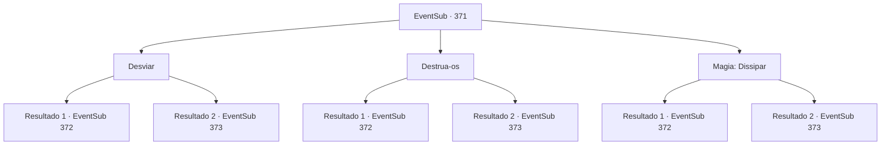

# Eventos secundários · 371

[Índice da tabela](index.md) · [Índice geral](../index.md)

ID: `pt:EventSub:371` · Fonte: `EventSub4` · Versão: 1.2.47.

Mapeamento estático dos arquivos; a disponibilidade e a execução dependem do estado da run.

## Texto do evento

*Sem texto no arquivo.*

## Dados de entrada

```json
{
  "id": 371,
  "grade": 1,
  "subEvent": "",
  "required": ""
}
```

## Mapa das escolhas



## Escolhas e resultados

### Escolha 1

Desviar

Requisitos e outros campos da escolha:

```json
{
  "required": ""
}
```

#### Resultado 1.1

As raízes da árvore falham em enrolar você e se emaranham entre si. Syannathel morde os lábios. 

 "Urgh..! Você deveria ter sido amarrado silenciosamente!"

 Você e Amakar a encaram.

Continuação registrada: [Evento 372](0372.md) na mesma tabela.

```json
{
  "required": "",
  "chance": "1|0_6_1",
  "nextEvent": 372,
  "type": 0,
  "reward": "6_0_139",
  "place": 10
}
```

#### Resultado 1.2

As raízes da árvore emergiram do chão e te enroscaram, eventualmente estrangulando seu pescoço. Você luta com força, mas acaba desmaiando. Quando recobra a consciência, a batalha já acabou. Você abre os olhos em um hospital de campanha. Ao se levantar, Amakar se aproxima e fala com você. 

 "Como você está se sentindo?"


Continuação registrada: [Evento 373](0373.md) na mesma tabela.

```json
{
  "required": "",
  "chance": "16",
  "nextEvent": 373,
  "type": 1,
  "reward": ""
}
```

### Escolha 2

Destrua-os

Requisitos e outros campos da escolha:

```json
{
  "required": ""
}
```

#### Resultado 2.1

Você esmaga as raízes da árvore, enrolando-se ao redor do seu corpo. Syannathel morde os lábios. 

 "Urgh..! Você deveria ter sido amarrado silenciosamente!"

 Você e Amakar a encaram.

Continuação registrada: [Evento 372](0372.md) na mesma tabela.

```json
{
  "required": "",
  "chance": "1|0_5_1",
  "nextEvent": 372,
  "type": 0,
  "reward": "6_0_139",
  "place": 10
}
```

#### Resultado 2.2

As raízes da árvore emergiram do chão e te enroscaram, eventualmente estrangulando seu pescoço. Você luta com força, mas acaba desmaiando. Quando recobra a consciência, a batalha já acabou. Você abre os olhos em um hospital de campanha. Ao se levantar, Amakar se aproxima e fala com você. 

 "Como você está se sentindo?"


Continuação registrada: [Evento 373](0373.md) na mesma tabela.

```json
{
  "required": "",
  "chance": "22",
  "nextEvent": 373,
  "type": 1,
  "reward": ""
}
```

### Escolha 3

Magia: Dissipar

Requisitos e outros campos da escolha:

```json
{
  "required": "20_0_2|1_1_2"
}
```

#### Resultado 3.1

Você lança um feitiço num piscar de olhos e quebra a magia de Syannathel. Ela morde o lábio. 

 "Urgh..! Você deveria ter sido amarrado silenciosamente!"

 Você e Amakar enfrentam Syannathel.

Continuação registrada: [Evento 372](0372.md) na mesma tabela.

```json
{
  "required": "",
  "chance": "1|0_7_1|0_12_1",
  "nextEvent": 372,
  "type": 0,
  "reward": "6_0_139|0_1_-1",
  "place": 10
}
```

#### Resultado 3.2

As raízes da árvore emergiram do chão e te enroscaram, eventualmente estrangulando seu pescoço. Você luta com força, mas acaba desmaiando. Quando recobra a consciência, a batalha já acabou. Você abre os olhos em um hospital de campanha. Ao se levantar, Amakar se aproxima e fala com você. 

 "Como você está se sentindo?"


Continuação registrada: [Evento 373](0373.md) na mesma tabela.

```json
{
  "required": "",
  "chance": "18",
  "nextEvent": 373,
  "type": 1,
  "reward": "0_1_-1"
}
```

## Referências que chegam a este evento

- [Evento 368 · escolha 2 · resultado 1](0368.md#escolha-2)
- [Evento 370 · escolha 2 · resultado 1](0370.md#escolha-2)
