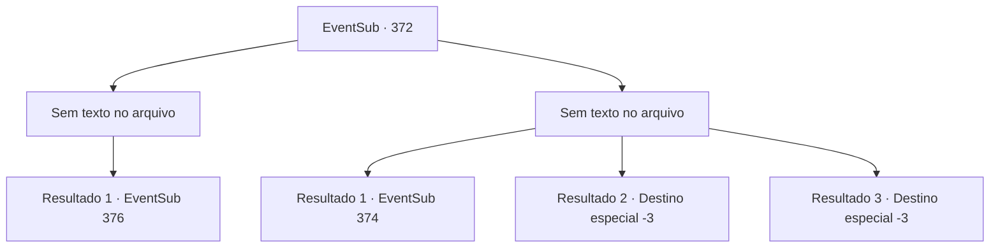

# Eventos secundários · 372

[Índice da tabela](index.md) · [Índice geral](../index.md)

ID: `pt:EventSub:372` · Fonte: `EventSub4` · Versão: 1.2.47.

Mapeamento estático dos arquivos; a disponibilidade e a execução dependem do estado da run.

## Texto do evento

*Sem texto no arquivo.*

## Dados de entrada

```json
{
  "id": 372,
  "grade": 1,
  "subEvent": "",
  "required": ""
}
```

## Mapa das escolhas



## Escolhas e resultados

### Escolha 1

*Sem texto no arquivo; o papel dessa opção depende da interface do jogo.*

Requisitos e outros campos da escolha:

```json
{
  "required": ""
}
```

#### Resultado 1.1

Syannathel resiste ferozmente, mas eventualmente você a derrota. Amakar tenta acorrentá-la. De repente, uma espessa fumaça aparece e obscurece a visão. 

 "Ah não..!"

 Amakar cria rapidamente um vento mágico e se livra da fumaça, mas os druidas já fugiram. Amakar olha ao redor e solta um longo suspiro. 

 "*suspiro* ...De alguma forma conseguimos afastá-los, mas isso não parece ser o fim. Teremos que fazê-los desistir da joia..."

 Ele olha para você como se estivesse pedindo sua opinião.

Continuação registrada: [Evento 376](0376.md) na mesma tabela.

```json
{
  "required": "",
  "chance": "1",
  "nextEvent": 376,
  "type": 2,
  "reward": ""
}
```

### Escolha 2

*Sem texto no arquivo; o papel dessa opção depende da interface do jogo.*

Requisitos e outros campos da escolha:

```json
{
  "required": ""
}
```

#### Resultado 2.1

Syannathel agarra você e joga você em Amakar. Você colide com ele e acaba rolando no chão juntos. Logo em seguida, um treant se aproxima e emaranha você e Amakar com raízes de árvores. 

 "Syannathel, encontre a joia imediatamente!"

 É um druida transformado em treant. 

 "O quê...! De jeito nenhum!!"

 Amakar luta com força, mas não consegue cortar a raiz da árvore. Eventualmente, adquirindo a joia escondida, os druidas se transformam em um bando de pássaros e voam para longe. Amakar grita para eles enquanto voam pelo céu. 

 "Vocês definitivamente pagarão o preço!!! Eu estou falando sério!"

 Como recompensa pela luta feroz, você e Amakar se libertam das raízes das árvores. Amakar olha ao redor com uma expressão sombria. Apertando os dentes, ele fala. 

 "Devemos permanecer calmos em momentos como esses... A prioridade é recuperar os danos sofridos."

 Ele parece estar se tranquilizando. Ele esfrega a testa por um tempo e depois olha para você. 

 "Obrigado pela ajuda. Parece que você está ferido. Em primeiro lugar... você deve se tratar."


Continuação registrada: [Evento 374](0374.md) na mesma tabela.

```json
{
  "required": "1_0_2|1_1_2",
  "chance": "1",
  "nextEvent": 374,
  "type": 2,
  "reward": "0_0_-1|0_1_-1"
}
```

#### Resultado 2.2

Syannathel, que se transformou em uma águia, rasga sua vida com suas garras monstruosas. Você encontra a morte, olhando em seus olhos raivosos.

Continuação registrada: [Destino especial `-3`](../destinos-especiais.md).

```json
{
  "required": "2_0_2",
  "chance": "1",
  "nextEvent": -3,
  "type": 2,
  "reward": "0_0_-1|0_1_-1"
}
```

#### Resultado 2.3

Syannathel, que se transformou em uma águia, rasga sua vida com suas garras monstruosas. Você encontra a morte, olhando em seus olhos raivosos.

Continuação registrada: [Destino especial `-3`](../destinos-especiais.md).

```json
{
  "required": "2_1_2",
  "chance": "1",
  "nextEvent": -3,
  "type": 2,
  "reward": "0_0_-1|0_1_-1"
}
```

## Referências que chegam a este evento

- [Evento 371 · escolha 1 · resultado 1](0371.md#escolha-1)
- [Evento 371 · escolha 2 · resultado 1](0371.md#escolha-2)
- [Evento 371 · escolha 3 · resultado 1](0371.md#escolha-3)
