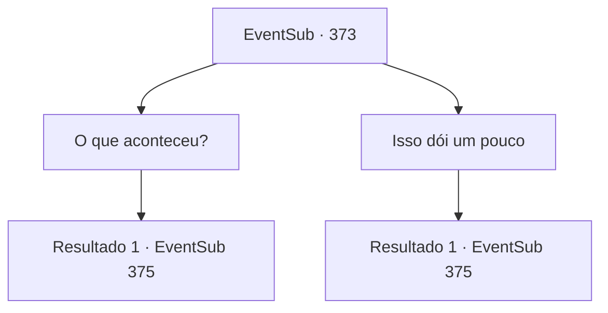

# Eventos secundários · 373

[Índice da tabela](index.md) · [Índice geral](../index.md)

ID: `pt:EventSub:373` · Fonte: `EventSub4` · Versão: 1.2.47.

Mapeamento estático dos arquivos; a disponibilidade e a execução dependem do estado da run.

## Texto do evento

*Sem texto no arquivo.*

## Dados de entrada

```json
{
  "id": 373,
  "grade": 1,
  "subEvent": "",
  "required": ""
}
```

## Mapa das escolhas



## Escolhas e resultados

### Escolha 1

O que aconteceu?

Requisitos e outros campos da escolha:

```json
{
  "required": ""
}
```

#### Resultado 1.1

Amakar suspira e responde à sua pergunta. 

 "Infelizmente... Perdemos a joia. Sem ela, a cidade voltará a ser estéril e os aldeões sofrerão. Precisamos tê-la de volta."

 Ele fala com um rosto determinado. 

 "Por favor, me ajude. Eu imploro a você."


Continuação registrada: [Evento 375](0375.md) na mesma tabela.

```json
{
  "required": "",
  "chance": "1",
  "nextEvent": 375,
  "type": 2,
  "reward": ""
}
```

### Escolha 2

Isso dói um pouco

Requisitos e outros campos da escolha:

```json
{
  "required": ""
}
```

#### Resultado 2.1

Amakar suspira e responde à sua pergunta. 

 "Você precisará de mais tempo para se recuperar. Perdoe-me por te sobrecarregar durante sua lesão, mas... por favor, me ajude a recuperar a joia."

 Ele diz que sem a joia, a cidade voltará a ser estéril e os aldeões sofrerão. Ele pede que você o ajude a trazer de volta a joia.

Continuação registrada: [Evento 375](0375.md) na mesma tabela.

```json
{
  "required": "",
  "chance": "1",
  "nextEvent": 375,
  "type": 2,
  "reward": ""
}
```

## Referências que chegam a este evento

- [Evento 369 · escolha 2 · resultado 1](0369.md#escolha-2)
- [Evento 371 · escolha 1 · resultado 2](0371.md#escolha-1)
- [Evento 371 · escolha 2 · resultado 2](0371.md#escolha-2)
- [Evento 371 · escolha 3 · resultado 2](0371.md#escolha-3)
