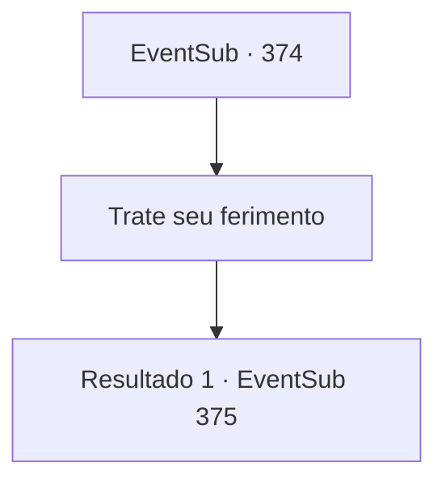

# Eventos secundários · 374

[Índice da tabela](index.md) · [Índice geral](../index.md)

ID: `pt:EventSub:374` · Fonte: `EventSub4` · Versão: 1.2.47.

Mapeamento estático dos arquivos; a disponibilidade e a execução dependem do estado da run.

## Texto do evento

*Sem texto no arquivo.*

## Dados de entrada

```json
{
  "id": 374,
  "grade": 1,
  "subEvent": "",
  "required": ""
}
```

## Mapa das escolhas



## Escolhas e resultados

### Escolha 1

Trate seu ferimento

Requisitos e outros campos da escolha:

```json
{
  "required": ""
}
```

#### Resultado 1.1

Você o escuta e segue para o hospital de campanha para curar sua lesão. Um médico passa uma pomada em suas feridas e as enfaixa. Amakar observa você sendo tratado e fala. 

 "Você precisará de mais tempo para se recuperar. Perdoe-me por te sobrecarregar durante sua lesão, mas... por favor, me ajude a recuperar a joia."

 Ele diz que sem a joia, a cidade voltará a ficar estéril e os aldeões sofrerão. Ele pede que você o ajude a trazer de volta a joia.

Continuação registrada: [Evento 375](0375.md) na mesma tabela.

```json
{
  "required": "",
  "chance": "1",
  "nextEvent": 375,
  "type": 2,
  "reward": "0_0_1"
}
```

## Referências que chegam a este evento

- [Evento 372 · escolha 2 · resultado 1](0372.md#escolha-2)
