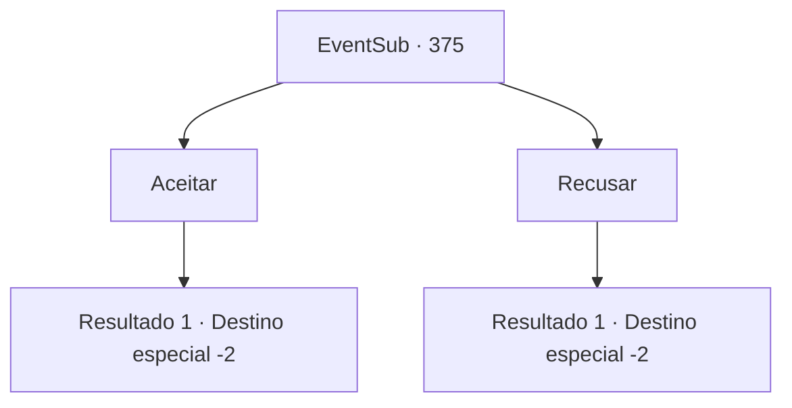

# Eventos secundários · 375

[Índice da tabela](index.md) · [Índice geral](../index.md)

ID: `pt:EventSub:375` · Fonte: `EventSub4` · Versão: 1.2.47.

Mapeamento estático dos arquivos; a disponibilidade e a execução dependem do estado da run.

## Texto do evento

*Sem texto no arquivo.*

## Dados de entrada

```json
{
  "id": 375,
  "grade": 1,
  "subEvent": "",
  "required": ""
}
```

## Mapa das escolhas



## Escolhas e resultados

### Escolha 1

Aceitar

Requisitos e outros campos da escolha:

```json
{
  "required": ""
}
```

#### Resultado 1.1

Você decide aceitar o pedido dele. Com um rosto determinado, ele segura sua mão e mostra sua gratidão. 

 "Obrigado. Se eu recuperar a joia, certamente vou te recompensar. Primeiro, vou consertar as áreas danificadas e me preparar para a guerra. Vou manter contato no momento certo."

 Amakar termina de falar, levanta-se e sai do hospital de campanha. Após o tratamento, você também sai da tenda e se move para outro lugar.

Continuação registrada: [Destino especial `-2`](../destinos-especiais.md).

```json
{
  "required": "",
  "chance": "1",
  "nextEvent": -2,
  "type": 2,
  "reward": "12_8_9"
}
```

### Escolha 2

Recusar

Requisitos e outros campos da escolha:

```json
{
  "required": ""
}
```

#### Resultado 2.1

Você balança a cabeça. Ele balança a cabeça com uma expressão de arrependimento. 

 "Tudo bem. Não posso pedir mais... Isso deve ser demais para você. Por favor, aceite isso. É um pequeno gesto de apreço."

 Amakar lhe entrega algum ouro, se levanta e sai do hospital de campanha. Após o tratamento, você também sai da tenda e se move para outro lugar.

Continuação registrada: [Destino especial `-2`](../destinos-especiais.md).

```json
{
  "required": "",
  "chance": "1",
  "nextEvent": -2,
  "type": 2,
  "reward": "0_4_30|12_8_-1"
}
```

## Referências que chegam a este evento

- [Evento 373 · escolha 1 · resultado 1](0373.md#escolha-1)
- [Evento 373 · escolha 2 · resultado 1](0373.md#escolha-2)
- [Evento 374 · escolha 1 · resultado 1](0374.md#escolha-1)
