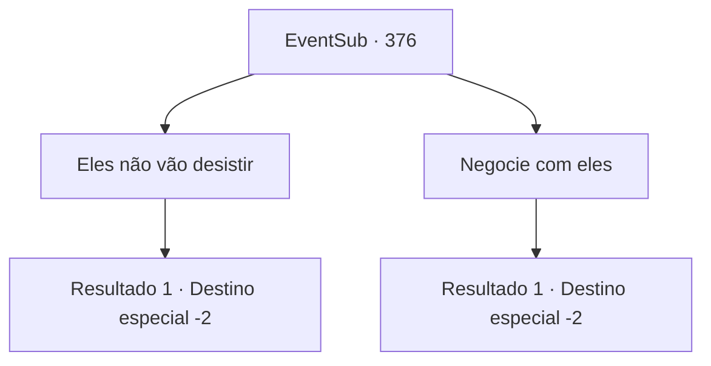

# Eventos secundários · 376

[Índice da tabela](index.md) · [Índice geral](../index.md)

ID: `pt:EventSub:376` · Fonte: `EventSub4` · Versão: 1.2.47.

Mapeamento estático dos arquivos; a disponibilidade e a execução dependem do estado da run.

## Texto do evento

*Sem texto no arquivo.*

## Dados de entrada

```json
{
  "id": 376,
  "grade": 1,
  "subEvent": "",
  "required": ""
}
```

## Mapa das escolhas



## Escolhas e resultados

### Escolha 1

Eles não vão desistir

Requisitos e outros campos da escolha:

```json
{
  "required": ""
}
```

#### Resultado 1.1

Amakar parece ter percebido algo. Ele balança a cabeça. 

 "Certo... terei que me livrar de todos eles. Se essa for a única maneira, que assim seja. Obrigado pela sua ajuda. Manterei contato em breve."

 Amakar lhe entrega algum ouro em troca. Então ele sai da mansão, dizendo que precisa resolver a confusão na cidade.

Continuação registrada: [Destino especial `-2`](../destinos-especiais.md).

```json
{
  "required": "",
  "chance": "1",
  "nextEvent": -2,
  "type": 2,
  "reward": "12_8_9|0_4_120|0_2_1"
}
```

### Escolha 2

Negocie com eles

Requisitos e outros campos da escolha:

```json
{
  "required": ""
}
```

#### Resultado 2.1

Você sugere a ele negociar com os druidas. Amakar pensa por um momento e então concorda com a cabeça. 

 "Tudo bem... Não tenho certeza se eles vão aceitar a oferta ou não, mas vamos tentar. Obrigado pela sua ajuda. Vou manter contato em breve."

 Amakar lhe entrega algum ouro em troca. Então ele deixa a mansão, dizendo que precisa resolver a confusão na cidade.

Continuação registrada: [Destino especial `-2`](../destinos-especiais.md).

```json
{
  "required": "",
  "chance": "1",
  "nextEvent": -2,
  "type": 2,
  "reward": "12_8_7|0_4_120|0_2_1"
}
```

## Referências que chegam a este evento

- [Evento 372 · escolha 1 · resultado 1](0372.md#escolha-1)
