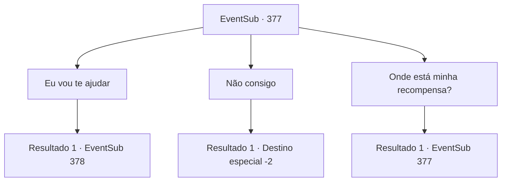

# Eventos secundários · 377

[Índice da tabela](index.md) · [Índice geral](../index.md)

ID: `pt:EventSub:377` · Fonte: `EventSub4` · Versão: 1.2.47.

Mapeamento estático dos arquivos; a disponibilidade e a execução dependem do estado da run.

## Texto do evento

No início da manhã, enquanto você está limpando seu acampamento improvisado, você vê uma grande águia voando em sua direção. Ele bate suas grandes asas à sua frente. Logo, uma voz familiar é ouvida da águia. 

 "Aventureiro! Sou eu, Syannathel. Um exército de Toment está atacando nossa floresta! Por favor nos ajude!"


## Dados de entrada

```json
{
  "id": 377,
  "grade": 1,
  "subEvent": "",
  "required": "12_8_5"
}
```

## Mapa das escolhas



## Escolhas e resultados

### Escolha 1

Eu vou te ajudar

Requisitos e outros campos da escolha:

```json
{
  "required": ""
}
```

#### Resultado 1.1

Você concorda em ajudá -la, assentindo. A águia voa para o ar, guiando o seu caminho para a floresta.

 Uma hora depois, você chega à floresta silociente externa. Com cuidado, você olha em volta. Ao contrário da última vez que você esteve aqui, os presos parecem uma floresta adequada agora. Syannathel Shapess de volta à sua forma humana e se esconde atrás de uma grande pedra.

Continuação registrada: [Evento 378](0378.md) na mesma tabela.

```json
{
  "required": "",
  "chance": "1",
  "nextEvent": 378,
  "type": 2,
  "reward": ""
}
```

### Escolha 2

Não consigo

Requisitos e outros campos da escolha:

```json
{
  "required": ""
}
```

#### Resultado 2.1

Você balança a cabeça. Syannathel, ainda em sua forma de águia, voa para o ar e desaparece.

Continuação registrada: [Destino especial `-2`](../destinos-especiais.md).

```json
{
  "required": "",
  "chance": "1",
  "nextEvent": -2,
  "type": 2,
  "reward": "12_8_6|5_329_1"
}
```

### Escolha 3

Onde está minha recompensa?

Requisitos e outros campos da escolha:

```json
{
  "required": "5_327_1"
}
```

#### Resultado 3.1

Ela responde à sua pergunta com uma voz preocupada. 

 "Aquilo... seria difícil no momento. Por favor, nos ajude mais uma vez. Nós definitivamente iremos recompensá-lo! Por favor, confie em nós!!"


Continuação registrada: [Evento 377](0377.md) na mesma tabela.

```json
{
  "required": "",
  "chance": "1",
  "nextEvent": 377,
  "type": 2,
  "reward": "5_327_2"
}
```

## Referências que chegam a este evento

- [Evento 377 · escolha 3 · resultado 1](0377.md#escolha-3)
