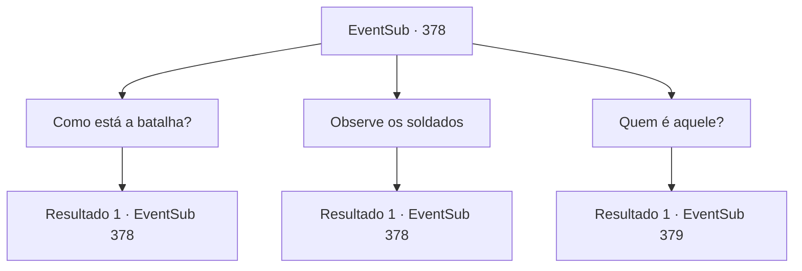

# Eventos secundários · 378

[Índice da tabela](index.md) · [Índice geral](../index.md)

ID: `pt:EventSub:378` · Fonte: `EventSub4` · Versão: 1.2.47.

Mapeamento estático dos arquivos; a disponibilidade e a execução dependem do estado da run.

## Texto do evento

*Sem texto no arquivo.*

## Dados de entrada

```json
{
  "id": 378,
  "grade": 1,
  "subEvent": "",
  "required": ""
}
```

## Mapa das escolhas



## Escolhas e resultados

### Escolha 1

Como está a batalha?

Requisitos e outros campos da escolha:

```json
{
  "required": "5_321_0"
}
```

#### Resultado 1.1


 "Soldados estão guardando a floresta... Eles devem estar impedindo os druidas de romperem o cerco."

 Roendo as unhas, ela diz que os druidas estão lutando contra a força principal de Tomant dentro da floresta. Ela acrescenta que, para se juntarem aos outros druidas, eles devem romper os soldados.

Continuação registrada: [Evento 378](0378.md) na mesma tabela.

```json
{
  "required": "",
  "chance": "1",
  "nextEvent": 378,
  "type": 2,
  "reward": "5_321_1"
}
```

### Escolha 2

Observe os soldados

Requisitos e outros campos da escolha:

```json
{
  "required": "5_321_1"
}
```

#### Resultado 2.1

Das margens da floresta, você observa lentamente seus arredores. Os soldados cansados estão bocejando, como se tivessem ficado alertas por muito tempo. Você olha ao redor do acampamento minuciosamente, mas não consegue encontrar Amakar. Nesse momento, um homem em uma armadura esplêndida aparece de uma tenda grande. Ele começa a selar o cavalo.

Continuação registrada: [Evento 378](0378.md) na mesma tabela.

```json
{
  "required": "",
  "chance": "1",
  "nextEvent": 378,
  "type": 2,
  "reward": "5_321_2"
}
```

### Escolha 3

Quem é aquele?

Requisitos e outros campos da escolha:

```json
{
  "required": "5_321_2"
}
```

#### Resultado 3.1

Syannathel sussurra em resposta à sua pergunta. 

 "Hmm... Pelo que me lembro, ele é o comandante de Tomant. Ele deve ter vindo aqui em vez de Amakar. Há um rumor de que ele era originalmente para ser o genro do senhorio."

 Ela acrescenta que descobriu essa informação enquanto pesquisava a situação política de Tomant. Enquanto isso, o comandante monta em seu cavalo e segue em direção à floresta. Syannathel pergunta como você pode romper as fileiras dos soldados e se juntar aos druidas.

Continuação registrada: [Evento 379](0379.md) na mesma tabela.

```json
{
  "required": "",
  "chance": "1",
  "nextEvent": 379,
  "type": 2,
  "reward": ""
}
```

## Referências que chegam a este evento

- [Evento 377 · escolha 1 · resultado 1](0377.md#escolha-1)
- [Evento 378 · escolha 1 · resultado 1](0378.md#escolha-1)
- [Evento 378 · escolha 2 · resultado 1](0378.md#escolha-2)
