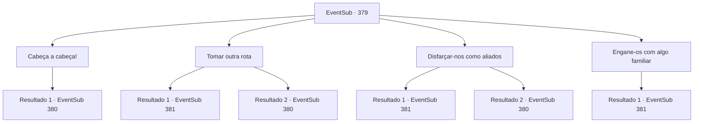

# Eventos secundários · 379

[Índice da tabela](index.md) · [Índice geral](../index.md)

ID: `pt:EventSub:379` · Fonte: `EventSub4` · Versão: 1.2.47.

Mapeamento estático dos arquivos; a disponibilidade e a execução dependem do estado da run.

## Texto do evento

*Sem texto no arquivo.*

## Dados de entrada

```json
{
  "id": 379,
  "grade": 1,
  "subEvent": "",
  "required": ""
}
```

## Mapa das escolhas



## Escolhas e resultados

### Escolha 1

Cabeça a cabeça!

Requisitos e outros campos da escolha:

```json
{
  "required": ""
}
```

#### Resultado 1.1

Seu plano é simplesmente derrotar todos os soldados que estão bloqueando seu caminho. Enquanto você avança, os soldados apontam suas armas para você, exigindo que você pare. No entanto, você os ignora e saca sua arma.

Continuação registrada: [Evento 380](0380.md) na mesma tabela.

```json
{
  "required": "",
  "chance": "1",
  "nextEvent": 380,
  "type": 2,
  "reward": "6_0_135",
  "place": 1
}
```

### Escolha 2

Tomar outra rota

Requisitos e outros campos da escolha:

```json
{
  "required": ""
}
```

#### Resultado 2.1

Você segue uma rota lateral para não encontrar soldados. Os guardas estão bem posicionados, mas não conseguem identificá-lo e Syannathel enquanto vocês dois se esgueiraram pela floresta.

 <link=shake>'clang! Clang! Rooooaaaar!'</link>

 Quanto mais profundo você entra na floresta, mais alto os ruídos se tornam. Algum tipo de fumaça também pode ser sentido. Está impedindo você da respiração. Você se move por um longo tempo. Finalmente, você e Syannathel chegam ao local da batalha. O lugar é um desastre. Corpos sangrentos deitado aqui e ali, e partes da floresta estão queimando. Você percebe que os druidas estão em menor número.

Continuação registrada: [Evento 381](0381.md) na mesma tabela.

```json
{
  "required": "",
  "chance": "1|0_6_1",
  "nextEvent": 381,
  "type": 0,
  "reward": ""
}
```

#### Resultado 2.2

Tentas escapar sorrateiramente em direção à floresta. Mas, apesar dos teus melhores esforços para passar despercebido, um grupo de soldados encontra-te. 

 "Temos um intruso! E um druida também! Matem-nos!"

 Os soldados correm em direção a vocês dois com suas armas em punho, gritando.

Continuação registrada: [Evento 380](0380.md) na mesma tabela.

```json
{
  "required": "",
  "chance": "13",
  "nextEvent": 380,
  "type": 1,
  "reward": "6_0_135",
  "place": 1
}
```

### Escolha 3

Disfarçar-nos como aliados

Requisitos e outros campos da escolha:

```json
{
  "required": ""
}
```

#### Resultado 3.1

Você tira os soldados adormecidos e usa sua armadura. Quando vocês dois entram na floresta, usando as armaduras, os soldados não o impedem.

 <link=shake>'clang! Clang! Rooooaaaar!'</link>

 Quanto mais profundo você entra na floresta, mais alto os ruídos se tornam. Algum tipo de fumaça também pode ser sentido. Está impedindo você da respiração. Você se move por um longo tempo. Finalmente, você e Syannathel chegam ao local da batalha. O lugar é um desastre. Corpos sangrentos deitado aqui e ali, e partes da floresta estão queimando. Você percebe que os druidas estão em menor número.

Continuação registrada: [Evento 381](0381.md) na mesma tabela.

```json
{
  "required": "",
  "chance": "1|0_12_1",
  "nextEvent": 381,
  "type": 0,
  "reward": ""
}
```

#### Resultado 3.2

Você domina os soldados adormecidos e pega suas armaduras. Você entra na floresta, usando suas armaduras, mas os soldados percebem facilmente seu disfarce. 

 "Ei, algo parece suspeito. Em qual ramo você pertence?"

 Você e Syannathel falham em responder e eventualmente sacam suas armas.

Continuação registrada: [Evento 380](0380.md) na mesma tabela.

```json
{
  "required": "",
  "chance": "13",
  "nextEvent": 380,
  "type": 1,
  "reward": "6_0_135",
  "place": 1
}
```

### Escolha 4

Engane-os com algo familiar

Requisitos e outros campos da escolha:

```json
{
  "required": "23_4_1"
}
```

#### Resultado 4.1

Você convoca um familiar e o envia para a floresta, ordenando que causasse um tumulto. A maioria dos soldados se espalhou para caçar o familiar, e isso oferece a oportunidade perfeita para se esgueirar por dentro. 

 <link=shake>'clang! Clang! Rooooaaaar!'</link>

 Quanto mais profundo você entra na floresta, mais alto os ruídos se tornam. Algum tipo de fumaça também pode ser sentido. Está impedindo você da respiração. Você se move por um longo tempo. Finalmente, você e Syannathel chegam ao local da batalha. O lugar é um desastre. Corpos sangrentos deitado aqui e ali, e partes da floresta estão queimando. Você percebe que os druidas estão em menor número.

Continuação registrada: [Evento 381](0381.md) na mesma tabela.

```json
{
  "required": "",
  "chance": "1",
  "nextEvent": 381,
  "type": 2,
  "reward": ""
}
```

## Referências que chegam a este evento

- [Evento 378 · escolha 3 · resultado 1](0378.md#escolha-3)
