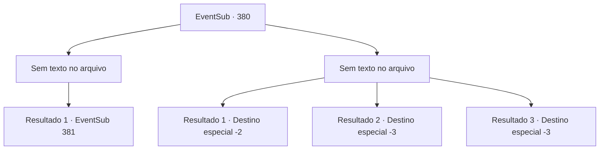

# Eventos secundários · 380

[Índice da tabela](index.md) · [Índice geral](../index.md)

ID: `pt:EventSub:380` · Fonte: `EventSub4` · Versão: 1.2.47.

Mapeamento estático dos arquivos; a disponibilidade e a execução dependem do estado da run.

## Texto do evento

*Sem texto no arquivo.*

## Dados de entrada

```json
{
  "id": 380,
  "grade": 1,
  "subEvent": "",
  "required": ""
}
```

## Mapa das escolhas



## Escolhas e resultados

### Escolha 1

*Sem texto no arquivo; o papel dessa opção depende da interface do jogo.*

Requisitos e outros campos da escolha:

```json
{
  "required": ""
}
```

#### Resultado 1.1

Você derrota todos os soldados bloqueando seu caminho e chega com sucesso para as partes internas da floresta. 

 <link=shake>'clang! Clang! Rooooaaaar!'</link>

 Quanto mais profundo você entra na floresta, mais alto os ruídos se tornam. Algum tipo de fumaça também pode ser sentido. Está impedindo você da respiração. Você se move por um longo tempo. Finalmente, você e Syannathel chegam ao local da batalha. O lugar é um desastre. Corpos sangrentos deitado aqui e ali, e partes da floresta estão queimando. Você percebe que os druidas estão em menor número.

Continuação registrada: [Evento 381](0381.md) na mesma tabela.

```json
{
  "required": "",
  "chance": "1",
  "nextEvent": 381,
  "type": 2,
  "reward": ""
}
```

### Escolha 2

*Sem texto no arquivo; o papel dessa opção depende da interface do jogo.*

Requisitos e outros campos da escolha:

```json
{
  "required": ""
}
```

#### Resultado 2.1

Apesar de inicialmente avançar contra eles com grande confiança, agora você está sendo caçado pelos soldados. Depois de fugir desesperadamente da Floresta de Silocient, eles não te perseguem mais. Você não consegue reunir coragem para entrar na floresta novamente. Você se afasta em busca de uma cidade.

Continuação registrada: [Destino especial `-2`](../destinos-especiais.md).

```json
{
  "required": "1_0_2|1_1_2",
  "chance": "1",
  "nextEvent": -2,
  "type": 2,
  "reward": "0_0_-1|0_1_-1|12_8_6"
}
```

#### Resultado 2.2

Apesar de inicialmente avançar contra eles com grande confiança, agora você está sendo caçado pelos soldados. Eles nem mesmo pedem para você se render. Eles te empalam com suas lanças.

Continuação registrada: [Destino especial `-3`](../destinos-especiais.md).

```json
{
  "required": "2_0_2",
  "chance": "1",
  "nextEvent": -3,
  "type": 2,
  "reward": "0_0_-1|0_1_-1"
}
```

#### Resultado 2.3

Apesar de inicialmente avançar contra eles com grande confiança, agora você está sendo caçado pelos soldados. Eles nem mesmo pedem para você se render. Eles te empalam com suas lanças.

Continuação registrada: [Destino especial `-3`](../destinos-especiais.md).

```json
{
  "required": "2_1_2",
  "chance": "1",
  "nextEvent": -3,
  "type": 2,
  "reward": "0_0_-1|0_1_-1"
}
```

## Referências que chegam a este evento

- [Evento 379 · escolha 1 · resultado 1](0379.md#escolha-1)
- [Evento 379 · escolha 2 · resultado 2](0379.md#escolha-2)
- [Evento 379 · escolha 3 · resultado 2](0379.md#escolha-3)
