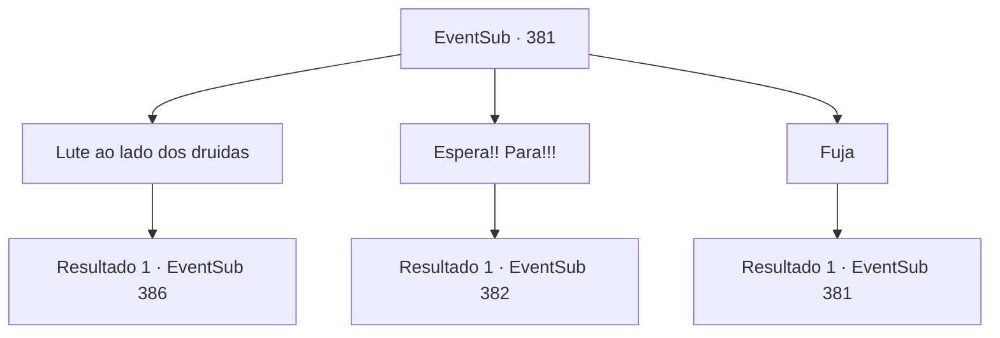

# Eventos secundários · 381

[Índice da tabela](index.md) · [Índice geral](../index.md)

ID: `pt:EventSub:381` · Fonte: `EventSub4` · Versão: 1.2.47.

Mapeamento estático dos arquivos; a disponibilidade e a execução dependem do estado da run.

## Texto do evento

*Sem texto no arquivo.*

## Dados de entrada

```json
{
  "id": 381,
  "grade": 1,
  "subEvent": "",
  "required": ""
}
```

## Mapa das escolhas



## Escolhas e resultados

### Escolha 1

Lute ao lado dos druidas

Requisitos e outros campos da escolha:

```json
{
  "required": ""
}
```

#### Resultado 1.1

Você vem em auxílio dos druidas, com suas armas em punho. Os druidas são incentivados pela sua aparição, seguindo você para mais uma batalha sangrenta. Os sons dos gritos de guerra dos soldados fazem um arrepio percorrer sua espinha.

Continuação registrada: [Evento 386](0386.md) na mesma tabela.

```json
{
  "required": "",
  "chance": "1",
  "nextEvent": 386,
  "type": 2,
  "reward": "6_0_136",
  "place": 1
}
```

### Escolha 2

Espera!! Para!!!

Requisitos e outros campos da escolha:

```json
{
  "required": ""
}
```

#### Resultado 2.1

Você pula no meio da batalha, gritando com todas as suas forças. Apesar do seu grito entusiasmado, a luta não para. No entanto, você chama a atenção do comandante do Tomant. 

 "O que você está fazendo?!"


Continuação registrada: [Evento 382](0382.md) na mesma tabela.

```json
{
  "required": "",
  "chance": "1",
  "nextEvent": 382,
  "type": 2,
  "reward": ""
}
```

### Escolha 3

Fuja

Requisitos e outros campos da escolha:

```json
{
  "required": "5_322_0"
}
```

#### Resultado 3.1

Vocês gritam para os druidas abandonarem a floresta e fugirem. Mas os druidas balançam a cabeça em recusa. 

 "Eles planejam queimar esta floresta e pegar a Joia da Vida! E vocês esperam que nós apenas fujamos?!"

 Os druidas respondem que continuarão lutando. Então, o comandante do exército vem gritando, exigindo que eles devolvam a joia.

Continuação registrada: [Evento 381](0381.md) na mesma tabela.

```json
{
  "required": "",
  "chance": "1",
  "nextEvent": 381,
  "type": 2,
  "reward": "5_322_1"
}
```

## Referências que chegam a este evento

- [Evento 379 · escolha 2 · resultado 1](0379.md#escolha-2)
- [Evento 379 · escolha 3 · resultado 1](0379.md#escolha-3)
- [Evento 379 · escolha 4 · resultado 1](0379.md#escolha-4)
- [Evento 380 · escolha 1 · resultado 1](0380.md#escolha-1)
- [Evento 381 · escolha 3 · resultado 1](0381.md#escolha-3)
