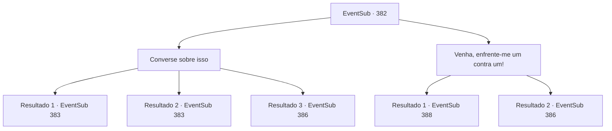

# Eventos secundários · 382

[Índice da tabela](index.md) · [Índice geral](../index.md)

ID: `pt:EventSub:382` · Fonte: `EventSub4` · Versão: 1.2.47.

Mapeamento estático dos arquivos; a disponibilidade e a execução dependem do estado da run.

## Texto do evento

*Sem texto no arquivo.*

## Dados de entrada

```json
{
  "id": 382,
  "grade": 1,
  "subEvent": "",
  "required": ""
}
```

## Mapa das escolhas



## Escolhas e resultados

### Escolha 1

Converse sobre isso

Requisitos e outros campos da escolha:

```json
{
  "required": ""
}
```

#### Resultado 1.1

Você pede ao comandante por uma discussão. Ele olha nos seus olhos por um momento e grita para os soldados. 

 "Tropas! Recuem por um momento!"

 Os soldados param de lutar e recuam, seguindo suas ordens. O comandante olha para você e pergunta com interesse. 

 "...Vou ouvir o que você tem a dizer, por enquanto."


Continuação registrada: [Evento 383](0383.md) na mesma tabela.

```json
{
  "required": "",
  "chance": "1|0_12_1",
  "nextEvent": 383,
  "type": 0,
  "reward": ""
}
```

#### Resultado 1.2

Você pede ao comandante por uma discussão. Ele olha nos seus olhos por um momento e grita para os soldados. 

 "Tropas! Recuem por um momento!"

 Os soldados param de lutar e recuam, seguindo suas ordens. O comandante olha para você e pergunta com interesse. 

 "...Vou ouvir o que você tem a dizer, por enquanto."


Continuação registrada: [Evento 383](0383.md) na mesma tabela.

```json
{
  "required": "",
  "chance": "1|0_12_1",
  "nextEvent": 383,
  "type": 0,
  "reward": ""
}
```

#### Resultado 1.3

Você sugere parar a batalha e conversar sobre isso. No entanto, ele resmunga e te questiona de volta. 

 "Haha! Isso nem foi engraçado. Não vale a pena ouvir. Eu não sei quem diabos você é, mas não vou te perseguir se você fugir. Se não... Eu vou te matar como aqueles selvagens e pendurar seu corpo na parede! Ataque!"

 Com o grito do comandante, a moral dos soldados aumenta ainda mais. Vendo que eles não têm intenção de recuar, você saca sua arma.

Continuação registrada: [Evento 386](0386.md) na mesma tabela.

```json
{
  "required": "",
  "chance": "36",
  "nextEvent": 386,
  "type": 1,
  "reward": "6_0_136",
  "place": 1
}
```

### Escolha 2

Venha, enfrente-me um contra um!

Requisitos e outros campos da escolha:

```json
{
  "required": ""
}
```

#### Resultado 2.1

Você grita seu nome e cidade natal. Em seguida, sugere um combate singular honroso para decidir o resultado da batalha. O comandante aceita sua oferta e fica em pé diante de você com orgulho. 

 "Justo. Eu, 'Lophenbach de Tomant', aceito o pedido de duelo de {1}."

 Então ele puxa uma espada de sua cintura.

Continuação registrada: [Evento 388](0388.md) na mesma tabela.

```json
{
  "required": "1_2_50",
  "chance": "1",
  "nextEvent": 388,
  "type": 2,
  "reward": "6_0_137",
  "place": 1
}
```

#### Resultado 2.2

Você grita seu nome e cidade natal. Em seguida, sugere um combate singular honroso para decidir o resultado da batalha. No entanto, o comandante resmunga e responde. 

 "Ha! Desde quando um vagabundo tem honra? Tropas, ataquem!"

 Com o grito do comandante, a moral dos soldados aumenta ainda mais. Vendo que eles não têm intenção de recuar, você saca sua arma.

Continuação registrada: [Evento 386](0386.md) na mesma tabela.

```json
{
  "required": "2_2_50",
  "chance": "1",
  "nextEvent": 386,
  "type": 2,
  "reward": "6_0_136",
  "place": 1
}
```

## Referências que chegam a este evento

- [Evento 381 · escolha 2 · resultado 1](0381.md#escolha-2)
