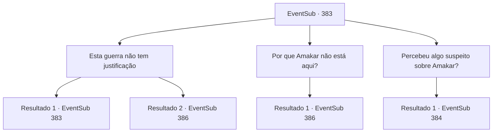

# Eventos secundários · 383

[Índice da tabela](index.md) · [Índice geral](../index.md)

ID: `pt:EventSub:383` · Fonte: `EventSub4` · Versão: 1.2.47.

Mapeamento estático dos arquivos; a disponibilidade e a execução dependem do estado da run.

## Texto do evento

*Sem texto no arquivo.*

## Dados de entrada

```json
{
  "id": 383,
  "grade": 1,
  "subEvent": "",
  "required": ""
}
```

## Mapa das escolhas



## Escolhas e resultados

### Escolha 1

Esta guerra não tem justificação

Requisitos e outros campos da escolha:

```json
{
  "required": "5_330_0"
}
```

#### Resultado 1.1

O comandante pergunta de volta, sobre que bobagem você está falando. Você explica a ele como Amakar roubou a joia em primeiro lugar, e como essa perda foi crítica para os druidas. Você enfatiza que o roubo de Amakar é a causa raiz do conflito entre Tomant e os druidas, e os soldados do comandante apenas sangram e morrem devido ao egoísmo dele. Após falar, você examina o comandante e os soldados ao seu redor. Eles estão ouvindo você ansiosamente, mas ainda parecem incertos.

Continuação registrada: [Evento 383](0383.md) na mesma tabela.

```json
{
  "required": "",
  "chance": "1|0_7_1",
  "nextEvent": 383,
  "type": 0,
  "reward": "5_330_1"
}
```

#### Resultado 1.2

O comandante pergunta de volta, sobre que bobagem você está falando. Você explica a ele como Amakar roubou a joia em primeiro lugar e como essa perda foi crítica para os druidas. No entanto, ele não parece convencido. 

 "Haha! Isso nem foi engraçado. Não vale a pena ouvir. Eu não sei quem diabos você é, mas não vou te perseguir se você fugir. Se não... Eu vou te matar como aqueles selvagens e pendurar seu corpo na parede! Ataque!"

 Com o grito do comandante, a moral dos soldados aumenta ainda mais. Vendo que eles não têm intenção de recuar, você saca sua arma.

Continuação registrada: [Evento 386](0386.md) na mesma tabela.

```json
{
  "required": "",
  "chance": "25",
  "nextEvent": 386,
  "type": 1,
  "reward": "6_0_136",
  "place": 1
}
```

### Escolha 2

Por que Amakar não está aqui?

Requisitos e outros campos da escolha:

```json
{
  "required": "5_330_1"
}
```

#### Resultado 2.1

Você olha em volta dos soldados alinhados e pergunta. No entanto, nenhum deles responde à pergunta. Você afirma que Amakar não luta com essa batalha porque ele tem medo da 'maldição' dos druidas. Com suas palavras, os soldados começam a murmurar com um visual confuso. À medida que o murmúrio se espalha, o comandante grita apressadamente para acalmá -los. 

 "Não entrar em pânico! Ele está tentando perturbar você! Devemos recuperar o tesouro da cidade a qualquer custo! Tropas, Charge !!"

 Os soldados cobram sua ordem, mas com moral inferior do que antes.

Continuação registrada: [Evento 386](0386.md) na mesma tabela.

```json
{
  "required": "",
  "chance": "1",
  "nextEvent": 386,
  "type": 2,
  "reward": "6_2_136",
  "place": 1
}
```

### Escolha 3

Percebeu algo suspeito sobre Amakar?

Requisitos e outros campos da escolha:

```json
{
  "required": "5_330_1"
}
```

#### Resultado 3.1

Você pergunta se eles perceberam algo suspeito sobre Amakar. Nenhum deles responde, mas você percebe um olhar confuso nos olhos do comandante. Você diz que Amakar foi apenas para Tomant para se casar com a filha do senhorio e, no final, conquistar o domínio. Ele precisa da joia para isso, e é por isso que ele começou essa guerra. Então o comandante fala com você. 

 "Hmm. Eu sou 'Lophenbach de Tomant'. Gostaria de conversar com você. Enquanto isso, vou pausar a batalha. O que você acha?"


Continuação registrada: [Evento 384](0384.md) na mesma tabela.

```json
{
  "required": "",
  "chance": "1",
  "nextEvent": 384,
  "type": 2,
  "reward": "5_330_2"
}
```

## Referências que chegam a este evento

- [Evento 382 · escolha 1 · resultado 1](0382.md#escolha-1)
- [Evento 382 · escolha 1 · resultado 2](0382.md#escolha-1)
- [Evento 383 · escolha 1 · resultado 1](0383.md#escolha-1)
