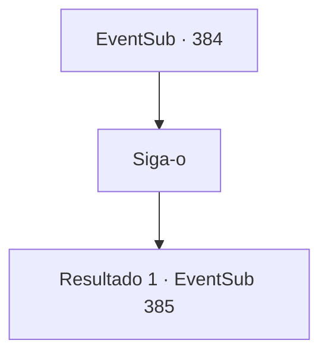

# Eventos secundários · 384

[Índice da tabela](index.md) · [Índice geral](../index.md)

ID: `pt:EventSub:384` · Fonte: `EventSub4` · Versão: 1.2.47.

Mapeamento estático dos arquivos; a disponibilidade e a execução dependem do estado da run.

## Texto do evento

*Sem texto no arquivo.*

## Dados de entrada

```json
{
  "id": 384,
  "grade": 1,
  "subEvent": "",
  "required": ""
}
```

## Mapa das escolhas



## Escolhas e resultados

### Escolha 1

Siga-o

Requisitos e outros campos da escolha:

```json
{
  "required": ""
}
```

#### Resultado 1.1

Sem outras opções, você aceita o pedido de Lophenbach. Os soldados recuam sob seu comando e você o segue até sua tenda. Ele se senta no assento do comandante e abre a boca. 

 "Me conte o que aconteceu antes de Amakar chegar a Tomant, em detalhes."

 Você fornece algumas informações que sabe, conforme ele pergunta. 

 "Então Amakar era um dos druidas, mas um renegado. E ele conheceu Selis, que estava procurando uma maneira de reviver Tomant. Amakar viu uma boa oportunidade de se estabelecer em um novo lugar. Então ele roubou a joia, fugiu e usou essa força para fazer Tomant prosperar."

 Ele esfrega o queixo e murmura o que ouviu. Então ele olha nos seus olhos e pergunta. 

 "Por que eu deveria acreditar em você?"


Continuação registrada: [Evento 385](0385.md) na mesma tabela.

```json
{
  "required": "",
  "chance": "1",
  "nextEvent": 385,
  "type": 2,
  "reward": ""
}
```

## Referências que chegam a este evento

- [Evento 383 · escolha 3 · resultado 1](0383.md#escolha-3)
