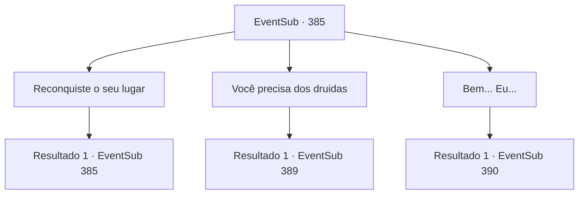

# Eventos secundários · 385

[Índice da tabela](index.md) · [Índice geral](../index.md)

ID: `pt:EventSub:385` · Fonte: `EventSub4` · Versão: 1.2.47.

Mapeamento estático dos arquivos; a disponibilidade e a execução dependem do estado da run.

## Texto do evento

*Sem texto no arquivo.*

## Dados de entrada

```json
{
  "id": 385,
  "grade": 1,
  "subEvent": "",
  "required": ""
}
```

## Mapa das escolhas



## Escolhas e resultados

### Escolha 1

Reconquiste o seu lugar

Requisitos e outros campos da escolha:

```json
{
  "required": "5_330_2"
}
```

#### Resultado 1.1

Você aponta o desejo secreto trancado em sua mente. 

 "O quê..! como...!!"

 Ele se levanta apressadamente com uma expressão de incredulidade. Então ele cambaleia de volta para o seu assento. Depois de bater na testa por um tempo, ele continua. 

 "...Certo. Vamos supor que você está falando a verdade. Então, por que eu não deveria simplesmente eliminar os druidas e pegar a joia?"


Continuação registrada: [Evento 385](0385.md) na mesma tabela.

```json
{
  "required": "",
  "chance": "1",
  "nextEvent": 385,
  "type": 2,
  "reward": "5_330_3"
}
```

### Escolha 2

Você precisa dos druidas

Requisitos e outros campos da escolha:

```json
{
  "required": "1_14_12|5_330_3"
}
```

#### Resultado 2.1

Você diz a ele que precisa de um ritual dos druidas para fazer uso da joia. Ouvindo suas palavras, Lophenbach recua e solta um longo suspiro. Depois de pensar por um tempo, ele se levanta com dificuldade. 

 "Eu vou retirar o exército. No entanto, os druidas devem fazer uma promessa de que nos emprestarão o poder da joia. E..."

 Ele pausa por um momento antes de continuar. 

 "Essa decisão é para Tomant. Não posso deixar meus homens sangrarem em vão. Vá contar aos druidas. Depois volte para mim e me diga como foi."


Continuação registrada: [Evento 389](0389.md) na mesma tabela.

```json
{
  "required": "",
  "chance": "1",
  "nextEvent": 389,
  "type": 2,
  "reward": ""
}
```

### Escolha 3

Bem... Eu...

Requisitos e outros campos da escolha:

```json
{
  "required": "2_14_12"
}
```

#### Resultado 3.1

Você falha em responder a pergunta dele. Ele se levanta de sua cadeira e fala. 

 "Eu lhe darei tempo para fugir. Ninguém irá impedir sua fuga da floresta. E eu esquecerei o que ouvi hoje."


Continuação registrada: [Evento 390](0390.md) na mesma tabela.

```json
{
  "required": "",
  "chance": "1",
  "nextEvent": 390,
  "type": 2,
  "reward": ""
}
```

## Referências que chegam a este evento

- [Evento 384 · escolha 1 · resultado 1](0384.md#escolha-1)
- [Evento 385 · escolha 1 · resultado 1](0385.md#escolha-1)
