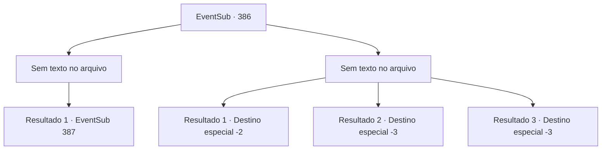

# Eventos secundários · 386

[Índice da tabela](index.md) · [Índice geral](../index.md)

ID: `pt:EventSub:386` · Fonte: `EventSub4` · Versão: 1.2.47.

Mapeamento estático dos arquivos; a disponibilidade e a execução dependem do estado da run.

## Texto do evento

*Sem texto no arquivo.*

## Dados de entrada

```json
{
  "id": 386,
  "grade": 1,
  "subEvent": "",
  "required": ""
}
```

## Mapa das escolhas



## Escolhas e resultados

### Escolha 1

*Sem texto no arquivo; o papel dessa opção depende da interface do jogo.*

Requisitos e outros campos da escolha:

```json
{
  "required": ""
}
```

#### Resultado 1.1

Os soldados ficam aterrorizados com suas excelentes habilidades de combate e começam a fugir. O medo se espalha em um instante, fazendo com que as tropas se retirem.

 No entanto, mesmo após os retiros do Exército de Tomant, os rostos dos druidas permanecem escuros. Eles suspiram na floresta queimada, e alguns até caíram em lágrimas. Você se aproxima dos druidas sombrios. Um deles, um velho druida com barba longa, olha para você e fala. 

 "Muito obrigado. Gostaria de apreciá -lo mais sinceramente, mas lamento que as coisas não estejam indo bem."

 Ele se apresenta como o druida mais velho e segura sua mão. Então ele fala com cuidado. 

 "Eu não deveria te perguntar isso, mas você poderia nos ajudar um pouco mais?"


Continuação registrada: [Evento 387](0387.md) na mesma tabela.

```json
{
  "required": "",
  "chance": "1",
  "nextEvent": 387,
  "type": 2,
  "reward": ""
}
```

### Escolha 2

*Sem texto no arquivo; o papel dessa opção depende da interface do jogo.*

Requisitos e outros campos da escolha:

```json
{
  "required": ""
}
```

#### Resultado 2.1

Você luta com força, mas os soldados avançando te dominam. A maioria dos druidas perde suas vidas, e apenas alguns sobreviventes se dispersam para viver. Você, assim como eles, foge dos soldados.

Continuação registrada: [Destino especial `-2`](../destinos-especiais.md).

```json
{
  "required": "1_0_2|1_1_2",
  "chance": "1",
  "nextEvent": -2,
  "type": 2,
  "reward": "0_0_-1|0_1_-1|12_8_6"
}
```

#### Resultado 2.2

Você luta com força, mas os soldados avançando te dominam. No final, você é pisoteado por um exército implacável enquanto encontra a morte.

Continuação registrada: [Destino especial `-3`](../destinos-especiais.md).

```json
{
  "required": "2_0_2",
  "chance": "1",
  "nextEvent": -3,
  "type": 2,
  "reward": "0_0_-1|0_1_-1"
}
```

#### Resultado 2.3

Você luta com força, mas os soldados avançando te dominam. No final, você é pisoteado por um exército implacável enquanto encontra a morte.

Continuação registrada: [Destino especial `-3`](../destinos-especiais.md).

```json
{
  "required": "2_1_2",
  "chance": "1",
  "nextEvent": -3,
  "type": 2,
  "reward": "0_0_-1|0_1_-1"
}
```

## Referências que chegam a este evento

- [Evento 381 · escolha 1 · resultado 1](0381.md#escolha-1)
- [Evento 382 · escolha 1 · resultado 3](0382.md#escolha-1)
- [Evento 382 · escolha 2 · resultado 2](0382.md#escolha-2)
- [Evento 383 · escolha 1 · resultado 2](0383.md#escolha-1)
- [Evento 383 · escolha 2 · resultado 1](0383.md#escolha-2)
- [Evento 388 · escolha 2 · resultado 1](0388.md#escolha-2)
- [Evento 390 · escolha 1 · resultado 1](0390.md#escolha-1)
