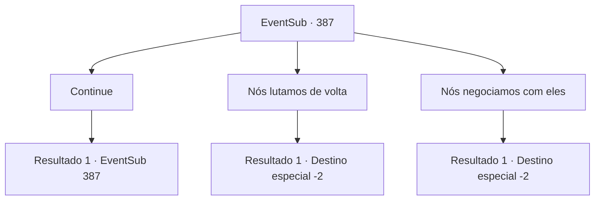

# Eventos secundários · 387

[Índice da tabela](index.md) · [Índice geral](../index.md)

ID: `pt:EventSub:387` · Fonte: `EventSub4` · Versão: 1.2.47.

Mapeamento estático dos arquivos; a disponibilidade e a execução dependem do estado da run.

## Texto do evento

*Sem texto no arquivo.*

## Dados de entrada

```json
{
  "id": 387,
  "grade": 1,
  "subEvent": "",
  "required": ""
}
```

## Mapa das escolhas



## Escolhas e resultados

### Escolha 1

Continue

Requisitos e outros campos da escolha:

```json
{
  "required": "5_323_0"
}
```

#### Resultado 1.1

Enquanto você assente com a cabeça, ele suspira e fala. 

 "Embora a floresta esteja queimada, ainda há esperança. Temos a Joia da Vida."

 Ele tira a joia e mostra para você. A Joia da Vida está brilhando com um brilho brilhante. 

 "O problema é que eles vão voltar. Eles recuaram desta vez, mas eles não nos invadirão novamente?"

 Com um olhar ansioso, ele diz que eles não recuarão uma segunda vez.

Continuação registrada: [Evento 387](0387.md) na mesma tabela.

```json
{
  "required": "",
  "chance": "1",
  "nextEvent": 387,
  "type": 2,
  "reward": "5_323_1"
}
```

### Escolha 2

Nós lutamos de volta

Requisitos e outros campos da escolha:

```json
{
  "required": "5_323_1"
}
```

#### Resultado 2.1

Você o encoraja a revidar. Syannathel, que estava ouvindo ao lado dele, concorda com a cabeça. 

 "Nós vencemos desta vez, então provavelmente venceremos a próxima batalha também. De qualquer forma, não podemos recuar."

 Os druidas hesitam por um momento, mas concordam de forma determinada. Syannathel olha para os druidas e depois se vira para você. 

 "Teria sido perigoso sem você, aventureiro. Obrigado por nos ajudar. Eu vou te enviar uma mensagem quando chegar a hora."

 Após falar, ela e os druidas começam a restaurar a floresta. Você os deixa trabalhar e se afasta da floresta.

Continuação registrada: [Destino especial `-2`](../destinos-especiais.md).

```json
{
  "required": "",
  "chance": "1",
  "nextEvent": -2,
  "type": 2,
  "reward": "12_8_8|5_323_2"
}
```

### Escolha 3

Nós negociamos com eles

Requisitos e outros campos da escolha:

```json
{
  "required": "5_323_1"
}
```

#### Resultado 3.1

Você sugere negociar, já que os druidas venceram a batalha e agora estão em uma posição vantajosa. Os druidas discutem minuciosamente por um tempo. O druida mais velho, com uma longa barba, se aproxima de você novamente e fala. 

 "Vamos tentar negociar, como você disse. Quando chegar a hora, eu te chamarei, já que agora você está profundamente envolvido nessa questão também. E obrigado pela sua ajuda. Teria sido perigoso sem você."

 Após falar, ele e os druidas começam a restaurar a floresta. Você os deixa trabalhar e se afasta da floresta.

Continuação registrada: [Destino especial `-2`](../destinos-especiais.md).

```json
{
  "required": "",
  "chance": "1",
  "nextEvent": -2,
  "type": 2,
  "reward": "12_8_12|5_323_2"
}
```

## Referências que chegam a este evento

- [Evento 386 · escolha 1 · resultado 1](0386.md#escolha-1)
- [Evento 387 · escolha 1 · resultado 1](0387.md#escolha-1)
- [Evento 388 · escolha 1 · resultado 1](0388.md#escolha-1)
