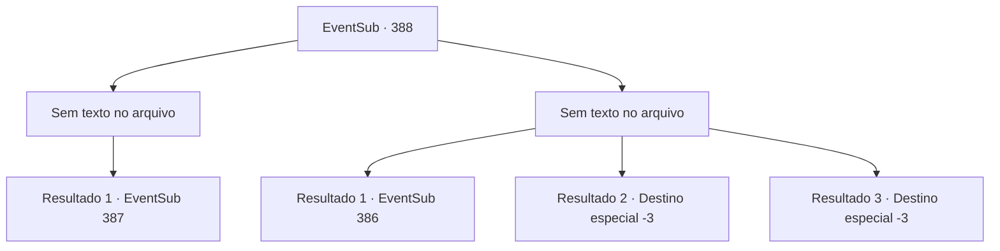

# Eventos secundários · 388

[Índice da tabela](index.md) · [Índice geral](../index.md)

ID: `pt:EventSub:388` · Fonte: `EventSub4` · Versão: 1.2.47.

Mapeamento estático dos arquivos; a disponibilidade e a execução dependem do estado da run.

## Texto do evento

*Sem texto no arquivo.*

## Dados de entrada

```json
{
  "id": 388,
  "grade": 1,
  "subEvent": "",
  "required": ""
}
```

## Mapa das escolhas



## Escolhas e resultados

### Escolha 1

*Sem texto no arquivo; o papel dessa opção depende da interface do jogo.*

Requisitos e outros campos da escolha:

```json
{
  "required": ""
}
```

#### Resultado 1.1


 "P...Pare! Eu me rendo..!!"

 Você venceu o comandante, forçando -o a admitir a derrota. O exército perde o moral e retira a floresta. Os homens do comandante deixam a floresta com sentimentos mistos de insatisfação e alívio.

 No entanto, mesmo depois que o exército de Tomant se retira, os rostos dos druidas permanecem escuros. Eles suspiram na floresta queimada, e alguns até caíram em lágrimas. Você se aproxima dos druidas sombrios. Um deles, um velho druida com barba longa, olha para você e fala. 

 "Muito obrigado. Eu gostaria de mostrar minha gratidão mais sinceramente, mas lamento que as coisas não estejam indo bem."

 Ele se apresenta como o druida mais velho e segura sua mão. Então ele fala com cuidado. 

 "Eu não deveria te perguntar isso, mas você poderia nos ajudar um pouco mais?"


Continuação registrada: [Evento 387](0387.md) na mesma tabela.

```json
{
  "required": "",
  "chance": "1",
  "nextEvent": 387,
  "type": 2,
  "reward": ""
}
```

### Escolha 2

*Sem texto no arquivo; o papel dessa opção depende da interface do jogo.*

Requisitos e outros campos da escolha:

```json
{
  "required": ""
}
```

#### Resultado 2.1

No momento em que você é derrotado, Syannathel se transforma em uma águia e ataca Lophenbach. Ela mergulha e arranha seus olhos, obrigando-o a recuar, gritando de agonia. Os soldados zombam furiosos e Lophenbach chora em sangue. 

 "Urgh... Vocês selvagens! Matem todos eles!!"

 Ao mesmo tempo, Syannathel exclama bruscamente. 

 "Agora não temos escolha a não ser lutar! Vamos proteger a floresta!"

 Ouvindo seu grito, você se levanta novamente e entra na luta.

Continuação registrada: [Evento 386](0386.md) na mesma tabela.

```json
{
  "required": "1_0_2|1_1_2",
  "chance": "1",
  "nextEvent": 386,
  "type": 2,
  "reward": "0_0_-1|0_1_-1|6_0_136",
  "place": 1
}
```

#### Resultado 2.2

O comandante possui uma habilidade marcial extrema. Suas habilidades são suficientes para separar sua cabeça do seu corpo.

Continuação registrada: [Destino especial `-3`](../destinos-especiais.md).

```json
{
  "required": "2_0_2",
  "chance": "1",
  "nextEvent": -3,
  "type": 2,
  "reward": "0_0_-1|0_1_-1"
}
```

#### Resultado 2.3

O comandante possui uma habilidade marcial extrema. Suas habilidades são suficientes para separar sua cabeça do seu corpo.

Continuação registrada: [Destino especial `-3`](../destinos-especiais.md).

```json
{
  "required": "2_1_2",
  "chance": "1",
  "nextEvent": -3,
  "type": 2,
  "reward": "0_0_-1|0_1_-1"
}
```

## Referências que chegam a este evento

- [Evento 382 · escolha 2 · resultado 1](0382.md#escolha-2)
