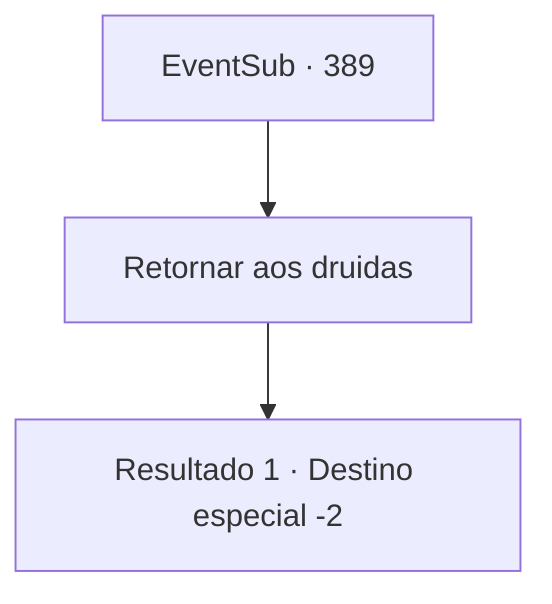

# Eventos secundários · 389

[Índice da tabela](index.md) · [Índice geral](../index.md)

ID: `pt:EventSub:389` · Fonte: `EventSub4` · Versão: 1.2.47.

Mapeamento estático dos arquivos; a disponibilidade e a execução dependem do estado da run.

## Texto do evento

*Sem texto no arquivo.*

## Dados de entrada

```json
{
  "id": 389,
  "grade": 1,
  "subEvent": "",
  "required": ""
}
```

## Mapa das escolhas



## Escolhas e resultados

### Escolha 1

Retornar aos druidas

Requisitos e outros campos da escolha:

```json
{
  "required": ""
}
```

#### Resultado 1.1

Você traz a condição de Lophenbach para os druidas. Os druidas logo se dividiram em dois lados, 'aceitáveis' e 'impossíveis'. Syannathel grita em frustração. 

 "Todos! Sem {1} aqui, todos estaríamos mortos, nem mesmo tendo a chance de negociar A floresta inteira deve ter sido queimada. Como {1} não pode nos proteger para sempre, não temos escolha a não ser aceitar a oferta, mesmo que tenhamos que emprestar o poder da jóia."

 Os druidas que tiveram objeções fecharam a boca, convencidos pelo discurso de Syannathel. Os druidas chegam a uma conclusão, e você e Syannathel decolam para encontrar Lophenbach. 

 "Prazer em conhecê-la. Eles me chamam de Lophenbach de Tomant."

 "Este é um syannatel da floresta silociente."

 Após uma breve introdução, eles discutem imediatamente o que fazer com a jóia. Eles alcançam um acordo que Tomant empresta a jóia apenas na primavera e no verão, para a agricultura. Após as negociações, Lophenbach retira o exército, como prometido. Enquanto o Exército se retira, os druidas se reúnem e apreciam você. 

 "Muito obrigado..! Você salvou minha pele ..."

 "Teria sido perigoso, se não fosse para você. Obrigada."

 Entre eles, o druida mais velho avança e lhe entrega algo. Parece um círculo de madeira. 

 "Por favor, aceite isso. É um presente para nos salvar do perigo."

 Você aceita o círculo e se despediu. Eles o acompanham para fora da floresta e acenam com as mãos até que não possam mais ser vistas.

Continuação registrada: [Destino especial `-2`](../destinos-especiais.md).

```json
{
  "required": "",
  "chance": "1",
  "nextEvent": -2,
  "type": 2,
  "reward": "12_8_-1|14_8_10|3_241_1"
}
```

## Referências que chegam a este evento

- [Evento 385 · escolha 2 · resultado 1](0385.md#escolha-2)
