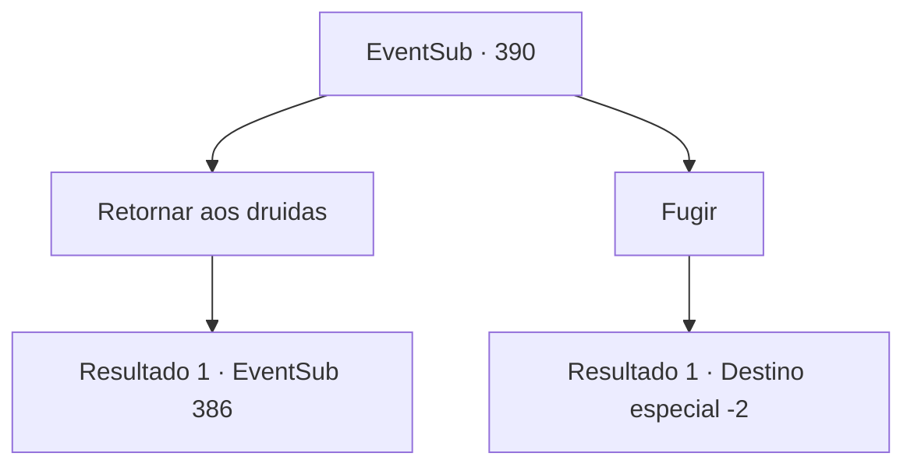

# Eventos secundários · 390

[Índice da tabela](index.md) · [Índice geral](../index.md)

ID: `pt:EventSub:390` · Fonte: `EventSub4` · Versão: 1.2.47.

Mapeamento estático dos arquivos; a disponibilidade e a execução dependem do estado da run.

## Texto do evento

*Sem texto no arquivo.*

## Dados de entrada

```json
{
  "id": 390,
  "grade": 1,
  "subEvent": "",
  "required": ""
}
```

## Mapa das escolhas



## Escolhas e resultados

### Escolha 1

Retornar aos druidas

Requisitos e outros campos da escolha:

```json
{
  "required": ""
}
```

#### Resultado 1.1

Você volta aos druidas e conta a eles o que Lophenbach disse. Os druidas ouvem você atentamente, com rostos determinados. Syannathel abre a boca. 

 "Tudo bem. Agora não temos escolha a não ser lutar juntos."

 Logo em seguida, o exército de Tomant se apressa novamente. 

 "Todos, vamos lutar e vencer!"

 Syannathel encoraja os druidas, marcando o início de outro banho de sangue na floresta.

Continuação registrada: [Evento 386](0386.md) na mesma tabela.

```json
{
  "required": "",
  "chance": "1",
  "nextEvent": 386,
  "type": 2,
  "reward": "6_0_136",
  "place": 1
}
```

### Escolha 2

Fugir

Requisitos e outros campos da escolha:

```json
{
  "required": ""
}
```

#### Resultado 2.1

Você decide não voltar para os druidas. Você passa silenciosamente pelos soldados e deixa a floresta.

Continuação registrada: [Destino especial `-2`](../destinos-especiais.md).

```json
{
  "required": "",
  "chance": "1",
  "nextEvent": -2,
  "type": 2,
  "reward": "12_8_6|5_329_1"
}
```

## Referências que chegam a este evento

- [Evento 385 · escolha 3 · resultado 1](0385.md#escolha-3)
