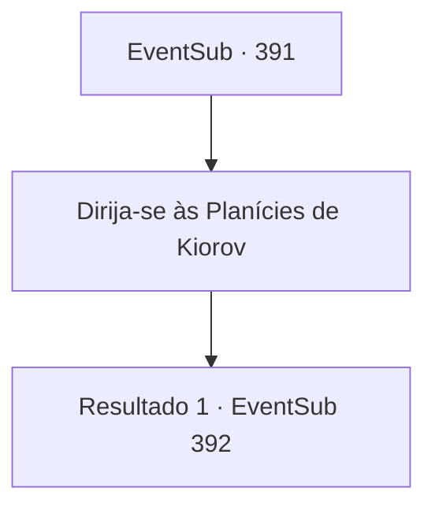

# Eventos secundários · 391

[Índice da tabela](index.md) · [Índice geral](../index.md)

ID: `pt:EventSub:391` · Fonte: `EventSub4` · Versão: 1.2.47.

Mapeamento estático dos arquivos; a disponibilidade e a execução dependem do estado da run.

## Texto do evento

Um corvo voa para você. Brilhando os olhos com um brilho verde, fala com a voz de Amakar. Amakar informa que as negociações entre Floresta Silociente e Tomant ocorrerão em breve e pede que você venha para as 'Planícies de Kiorov'.

## Dados de entrada

```json
{
  "id": 391,
  "grade": 1,
  "subEvent": "",
  "required": "12_8_7"
}
```

## Mapa das escolhas



## Escolhas e resultados

### Escolha 1

Dirija-se às Planícies de Kiorov

Requisitos e outros campos da escolha:

```json
{
  "required": ""
}
```

#### Resultado 1.1

Você vai para as planícies de Kiorov, como Amakar solicitou. 

 Chegando nas planícies de Kiorov, você percebe tendas com bandeiras de Tomant. Amakar sai de um deles. Ele o cumprimenta calorosamente e diz que as negociações em breve começariam. Então ele o leva à tenda onde a reunião acontecerá. Você entra na barraca e vê Syannathel e cerca de três druidas à mesa. Enquanto você e Amakar se sentam, Syannathel fala. 

 "Vamos direto ao ponto. A jóia tem sido um tesouro da nossa floresta desde o início. Você foi quem o roubou."

 Os druidas acenam com a cabeça no argumento de Syannathel.

Continuação registrada: [Evento 392](0392.md) na mesma tabela.

```json
{
  "required": "",
  "chance": "1",
  "nextEvent": 392,
  "type": 2,
  "reward": ""
}
```

## Referências que chegam a este evento

Nenhum `nextEvent` positivo da mesma tabela aponta para este nó. Isso não prova que seja inacessível: sorteio e estado de história podem selecioná-lo.

