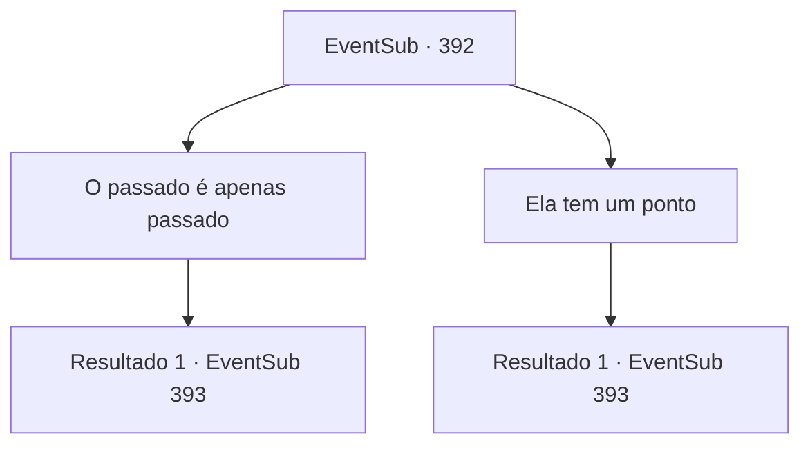

# Eventos secundários · 392

[Índice da tabela](index.md) · [Índice geral](../index.md)

ID: `pt:EventSub:392` · Fonte: `EventSub4` · Versão: 1.2.47.

Mapeamento estático dos arquivos; a disponibilidade e a execução dependem do estado da run.

## Texto do evento

*Sem texto no arquivo.*

## Dados de entrada

```json
{
  "id": 392,
  "grade": 1,
  "subEvent": "",
  "required": ""
}
```

## Mapa das escolhas



## Escolhas e resultados

### Escolha 1

O passado é apenas passado

Requisitos e outros campos da escolha:

```json
{
  "required": ""
}
```

#### Resultado 1.1

Você imediatamente contesta a afirmação de Syannathel. Você insiste que o passado é apenas passado. Você acrescenta que é Amakar quem realmente administrou a joia por muitos anos, e inúmeros aldeões se beneficiam da joia. Os druidas franzem a testa ao ouvir seu argumento. Examinando sua reação, Amakar abre a boca. 

 "Além disso, você é responsável pelos danos que nossa cidade sofreu durante seu ataque."

 Assim que ele termina de falar, um druida idoso ruge de raiva. 

 "Como você se atreve... Você ladrão...! Vergonha para você. Você não tem medo dos deuses?!"


Continuação registrada: [Evento 393](0393.md) na mesma tabela.

```json
{
  "required": "",
  "chance": "1",
  "nextEvent": 393,
  "type": 2,
  "reward": "5_331_1"
}
```

### Escolha 2

Ela tem um ponto

Requisitos e outros campos da escolha:

```json
{
  "required": ""
}
```

#### Resultado 2.1

Você ouve a afirmação de Syannathel e concorda. Amakar olha para você perplexo e fala. 

 "O joia também é um recurso crucial para nós. Dezenas de milhares de cidadãos vivem na cidade. Esse assunto é muito importante para ser baseado em propriedades passadas."

 Os druidas franzem a testa ao ouvirem seu argumento. Examinando a reação deles, Amakar abre a boca. 

 "Além disso, você é responsável pelos danos que nossa cidade sofreu durante seu ataque."

 Assim que ele termina de falar, um druida idoso ruge de raiva. 

 "Como você se atreve... Você ladrão...! Vergonha para você. Você não tem medo dos deuses?!"


Continuação registrada: [Evento 393](0393.md) na mesma tabela.

```json
{
  "required": "",
  "chance": "1",
  "nextEvent": 393,
  "type": 2,
  "reward": "5_331_2"
}
```

## Referências que chegam a este evento

- [Evento 391 · escolha 1 · resultado 1](0391.md#escolha-1)
