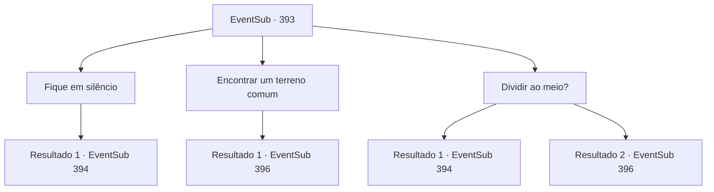

# Eventos secundários · 393

[Índice da tabela](index.md) · [Índice geral](../index.md)

ID: `pt:EventSub:393` · Fonte: `EventSub4` · Versão: 1.2.47.

Mapeamento estático dos arquivos; a disponibilidade e a execução dependem do estado da run.

## Texto do evento

*Sem texto no arquivo.*

## Dados de entrada

```json
{
  "id": 393,
  "grade": 1,
  "subEvent": "",
  "required": ""
}
```

## Mapa das escolhas



## Escolhas e resultados

### Escolha 1

Fique em silêncio

Requisitos e outros campos da escolha:

```json
{
  "required": ""
}
```

#### Resultado 1.1

Você observa a situação, em vez de cortar precipitadamente. No entanto, a reunião rapidamente se transforma em um desastre, já que não há ninguém para mediar. Amakar e Syannathel estão ocupados culpando um ao outro, e ambos os lados continuam repetindo os mesmos argumentos. Nesse exato momento, um soldado corre e grita. 

 "S...Senhor Amakar! É um ataque sorrateiro!!"

 Assim que ouvem a mensagem, os druidas rasgam a tenda e fogem. Você olha ao redor e vê chamas furiosas e uma espessa fumaça subindo ao céu.

Continuação registrada: [Evento 394](0394.md) na mesma tabela.

```json
{
  "required": "",
  "chance": "1",
  "nextEvent": 394,
  "type": 2,
  "reward": ""
}
```

### Escolha 2

Encontrar um terreno comum

Requisitos e outros campos da escolha:

```json
{
  "required": "1_14_15"
}
```

#### Resultado 2.1

Você reflete sobre esse assunto e pergunta aos druidas quando eles usaram o poder da joia. Um druida de longa barba responde. 

 "Assim como qualquer outra floresta, a Floresta Silocient começa a perder sua vitalidade no final do outono e, no inverno, as folhas secam. Com a força da joia, fomos capazes de manter a floresta verde o ano todo, como no verão. No entanto, nesses anos, não tivemos escolha senão implorar no inverno."

 Então, você pergunta a Amakar quando ele usou o poder da joia. 

 "Normalmente, usamos na primavera, quando as colheitas são plantadas, ou no verão para superar a seca..."


Continuação registrada: [Evento 396](0396.md) na mesma tabela.

```json
{
  "required": "",
  "chance": "1",
  "nextEvent": 396,
  "type": 2,
  "reward": ""
}
```

### Escolha 3

Dividir ao meio?

Requisitos e outros campos da escolha:

```json
{
  "required": ""
}
```

#### Resultado 3.1

No seu questionamento, os druidas chutam suas cadeiras e levantam. 

 "Um completo absurdo!"

 Amakar segue o exemplo com raiva, e a reunião rapidamente se transforma em um desastre. Nesse exato momento, um soldado entra correndo e grita. 

 "S...Senhor Amakar! É um ataque surpresa!!"

 Assim que ouvem a mensagem, os druidas rasgam a tenda e fogem. Você olha ao redor e vê chamas furiosas e uma densa fumaça subindo para o céu.

Continuação registrada: [Evento 394](0394.md) na mesma tabela.

```json
{
  "required": "5_331_1",
  "chance": "1",
  "nextEvent": 394,
  "type": 2,
  "reward": ""
}
```

#### Resultado 3.2

No seu questionamento, os druidas chutam suas cadeiras e se levantam. 

 "Um completo absurdo!"

 Nesse momento, Syannathel levanta a mão e fala. 

 "Hmm... Não podemos dividir a joia, mas talvez possamos compartilhá-la por turnos. Quando você precisa da joia em Tomant?"

 Amakar responde à pergunta dela. 

 "Normalmente a usamos na primavera, quando as colheitas são plantadas, ou no verão para superar a seca..."

 Então um druida de longa barba abre a boca. 

 "Assim como qualquer outra floresta, a Floresta Silocient começa a perder sua vitalidade no final do outono e, no inverno, as folhas secam. Com a força da joia, conseguimos manter a floresta verde o ano todo, como no verão. No entanto, nesses anos, não tivemos escolha a não ser implorar no inverno."


Continuação registrada: [Evento 396](0396.md) na mesma tabela.

```json
{
  "required": "5_331_2",
  "chance": "1",
  "nextEvent": 396,
  "type": 2,
  "reward": ""
}
```

## Referências que chegam a este evento

- [Evento 392 · escolha 1 · resultado 1](0392.md#escolha-1)
- [Evento 392 · escolha 2 · resultado 1](0392.md#escolha-2)
