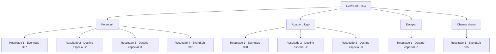

# Eventos secundários · 394

[Índice da tabela](index.md) · [Índice geral](../index.md)

ID: `pt:EventSub:394` · Fonte: `EventSub4` · Versão: 1.2.47.

Mapeamento estático dos arquivos; a disponibilidade e a execução dependem do estado da run.

## Texto do evento

*Sem texto no arquivo.*

## Dados de entrada

```json
{
  "id": 394,
  "grade": 1,
  "subEvent": "",
  "required": ""
}
```

## Mapa das escolhas



## Escolhas e resultados

### Escolha 1

Perseguir

Requisitos e outros campos da escolha:

```json
{
  "required": ""
}
```

#### Resultado 1.1

Você persegue os druidas rapidamente. Eles passam pelo prado e correm para a floresta, então você os segue para a floresta também. Então, o chão sob seus pés desaba. Logo antes de um enorme buraco te engolir, você pula agilmente por cima. Um druida te avista e fica na sua frente, segurando uma arma.

Continuação registrada: [Evento 397](0397.md) na mesma tabela.

```json
{
  "required": "21_10_1",
  "chance": "1|0_6_1",
  "nextEvent": 397,
  "type": 0,
  "reward": "6_0_138",
  "place": 1
}
```

#### Resultado 1.2

Você persegue os druidas rapidamente. Eles passam pelo prado e correm para a floresta, para que você os siga até a floresta também. Então, o chão sob seus pés cai e um enorme poço engole você. Você tem um preto. 

 Você perdeu o senso de tempo. Você recupera a consciência e consegue se afastar do poço. O acampamento é coberto de cinzas que costumavam ser tendas, e corpos de soldas de Tomant estão espalhados por toda parte. No entanto, os druidas e Amakar não estão em lugar algum. Você arrasta seu eu ferido para fora das ruínas.

Continuação registrada: [Destino especial `-2`](../destinos-especiais.md).

```json
{
  "required": "1_0_2|21_10_1",
  "chance": "14",
  "nextEvent": -2,
  "type": 1,
  "reward": "14_8_8|14_8_11|12_8_-1|0_0_-1"
}
```

#### Resultado 1.3

Você persegue os druidas rapidamente. Eles passam pelo prado e correm para a floresta, então você os segue para a floresta também. Então, o chão sob seus pés desaba e um enorme buraco te engole. Você desmaia.

Continuação registrada: [Destino especial `-3`](../destinos-especiais.md).

```json
{
  "required": "2_0_2|21_10_1",
  "chance": "14",
  "nextEvent": -3,
  "type": 1,
  "reward": "0_0_-1"
}
```

#### Resultado 1.4

Você persegue os druidas rapidamente. Eles passam pelo prado e correm para a floresta, então você os segue para a floresta também. Então, o chão sob seus pés desaba. Logo antes de um enorme buraco te engolir, você pula agilmente por cima. Um druida te avista e fica na sua frente, segurando uma arma.

Continuação registrada: [Evento 397](0397.md) na mesma tabela.

```json
{
  "required": "20_10_1",
  "chance": "1",
  "nextEvent": 397,
  "type": 0,
  "reward": "6_0_138",
  "place": 1
}
```

### Escolha 2

Apagar o fogo

Requisitos e outros campos da escolha:

```json
{
  "required": ""
}
```

#### Resultado 2.1

Você se apressa e ajuda a apagar o fogo. Após cerca de uma hora de trabalho árduo, carregando água e terra com os soldados, o fogo começa a diminuir. Quando você mal apaga o fogo, os druidas, acompanhados por bestas como uma águia, um lobo, um urso, saltam da floresta e se apressam em direção aos soldados. Os soldados, exaustos de apagar o fogo, desabam impotentes. Amakar se aproxima correndo e te pergunta. 

 "Por favor, ajude! Nesse ritmo, todos estão em perigo!!"

 Você e Amakar confrontam os druidas, atacando os soldados.

Continuação registrada: [Evento 398](0398.md) na mesma tabela.

```json
{
  "required": "",
  "chance": "1|0_13_1",
  "nextEvent": 398,
  "type": 0,
  "reward": "6_3_138",
  "place": 1
}
```

#### Resultado 2.2

Você tenta apagar o fogo, mas as chamas já ficaram fora de controle e se espalharam por todo o acampamento. Ao inspirar fumaça, você perde a mente e entra em colapso. 

 Você perdeu o senso de tempo. Você recupera a consciência e consegue se afastar do poço. O acampamento é coberto de cinzas que costumavam ser tendas, e corpos de soldas de Tomant estão espalhados por toda parte. No entanto, os druidas e Amakar não estão em lugar algum. Você arrasta seu eu ferido para fora das ruínas.

Continuação registrada: [Destino especial `-2`](../destinos-especiais.md).

```json
{
  "required": "1_0_2",
  "chance": "14",
  "nextEvent": -2,
  "type": 1,
  "reward": "14_8_8|14_8_11|12_8_-1|0_0_-1"
}
```

#### Resultado 2.3

Tentas apagar o fogo, mas as chamas já se espalharam por todo o acampamento. O fogo cresce descontroladamente e depois consome-te.

Continuação registrada: [Destino especial `-3`](../destinos-especiais.md).

```json
{
  "required": "2_0_2",
  "chance": "14",
  "nextEvent": -3,
  "type": 1,
  "reward": "0_0_-1"
}
```

### Escolha 3

Escapar

Requisitos e outros campos da escolha:

```json
{
  "required": ""
}
```

#### Resultado 3.1

Você sai apressadamente da mesa de negociação e foge do acampamento. O fogo ardente consome tudo atrás de você.

Continuação registrada: [Destino especial `-2`](../destinos-especiais.md).

```json
{
  "required": "",
  "chance": "1",
  "nextEvent": -2,
  "type": 2,
  "reward": "14_8_8|14_8_11|12_8_-1"
}
```

### Escolha 4

Chamar chuva

Requisitos e outros campos da escolha:

```json
{
  "required": "8_90_1"
}
```

#### Resultado 4.1

Você convoca nuvens escuras e então faz chover. As chamas ardentes e a fumaça diminuem gradualmente com a chuva. Depois de um tempo, o fogo se apaga completamente. Amakar olha para as ruínas que o fogo devastou e fala. 

 "Se não fosse por você, os danos teriam sido ainda mais graves. Obrigado."

 Ele diz que não há outra opção além de entrar em guerra total, com os soldados restantes. Então ele olha para você e pergunta. 

 "Você poderia me ajudar até o fim?"


Continuação registrada: [Evento 395](0395.md) na mesma tabela.

```json
{
  "required": "",
  "chance": "1",
  "nextEvent": 395,
  "type": 2,
  "reward": ""
}
```

## Referências que chegam a este evento

- [Evento 393 · escolha 1 · resultado 1](0393.md#escolha-1)
- [Evento 393 · escolha 3 · resultado 1](0393.md#escolha-3)
