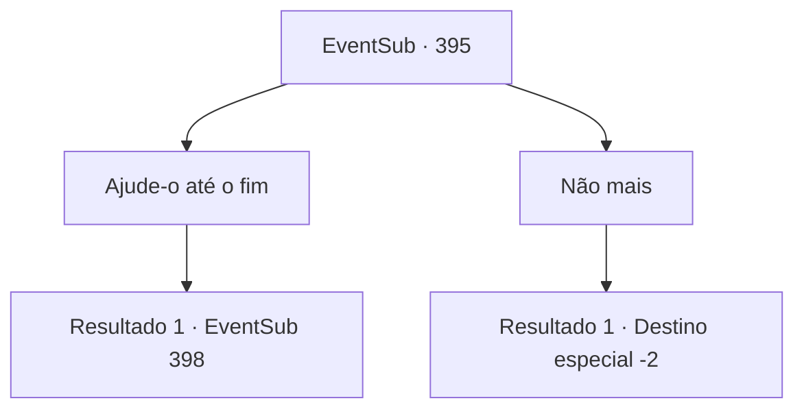

# Eventos secundários · 395

[Índice da tabela](index.md) · [Índice geral](../index.md)

ID: `pt:EventSub:395` · Fonte: `EventSub4` · Versão: 1.2.47.

Mapeamento estático dos arquivos; a disponibilidade e a execução dependem do estado da run.

## Texto do evento

*Sem texto no arquivo.*

## Dados de entrada

```json
{
  "id": 395,
  "grade": 1,
  "subEvent": "",
  "required": ""
}
```

## Mapa das escolhas



## Escolhas e resultados

### Escolha 1

Ajude-o até o fim

Requisitos e outros campos da escolha:

```json
{
  "required": ""
}
```

#### Resultado 1.1

Você concorda em ajudá-lo até o fim. Amakar reúne o restante de seus homens e marcha em direção aos druidas. Você está com ele. Assim que o exército chega à floresta, os druidas iniciam a batalha com uma emboscada. Você entra na luta, balançando sua arma contra eles.

Continuação registrada: [Evento 398](0398.md) na mesma tabela.

```json
{
  "required": "",
  "chance": "1",
  "nextEvent": 398,
  "type": 2,
  "reward": "6_3_138",
  "place": 1
}
```

### Escolha 2

Não mais

Requisitos e outros campos da escolha:

```json
{
  "required": ""
}
```

#### Resultado 2.1

Você responde que não pode mais ajudá-lo. Ele acena como se entendesse. 

 "Tudo bem. Você já nos ajudou muito, apagando o fogo. Este é um presente em agradecimento por salvar os soldados."

 Ele te entrega algum ouro, como um símbolo de sua gratidão. Você pega o ouro e se despede dele.

Continuação registrada: [Destino especial `-2`](../destinos-especiais.md).

```json
{
  "required": "",
  "chance": "1",
  "nextEvent": -2,
  "type": 2,
  "reward": "0_4_120|14_8_3|12_8_-1"
}
```

## Referências que chegam a este evento

- [Evento 394 · escolha 4 · resultado 1](0394.md#escolha-4)
